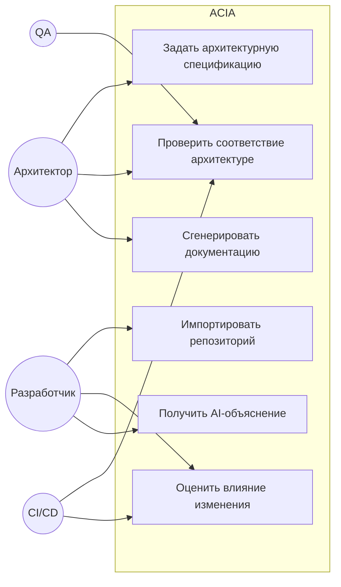
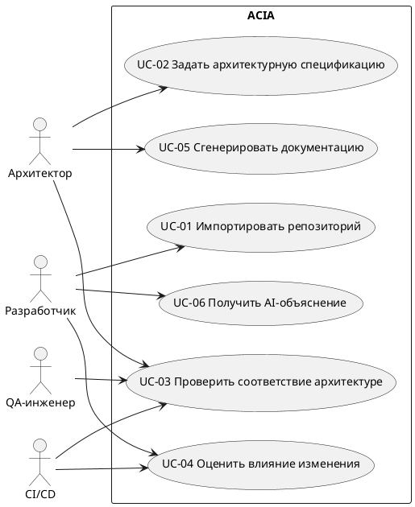
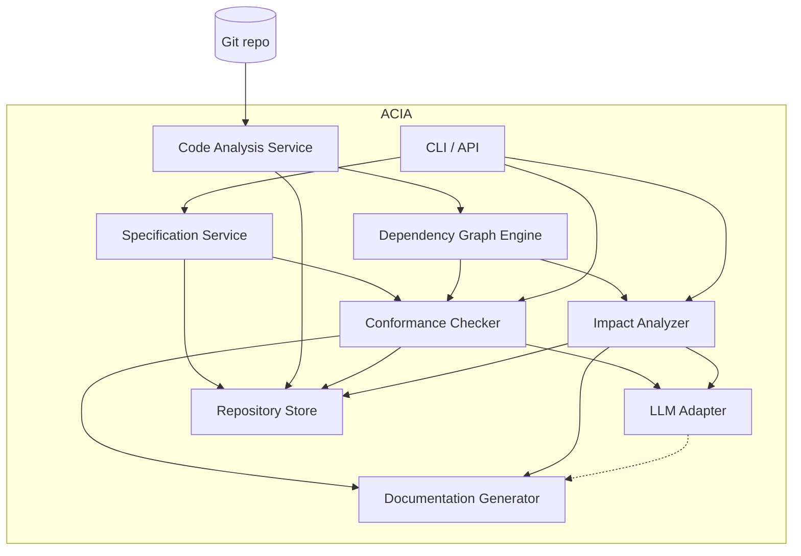
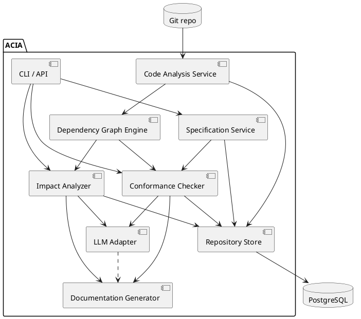
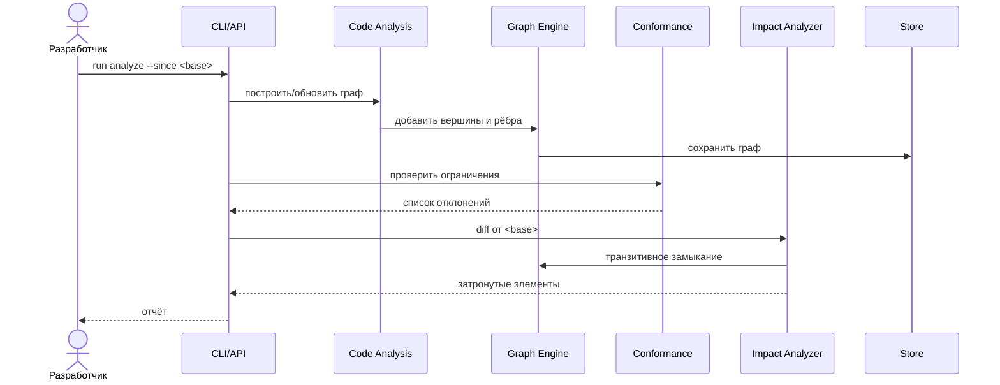
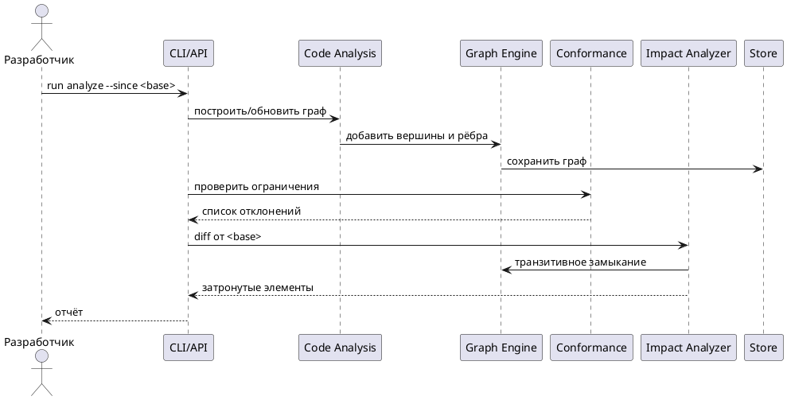
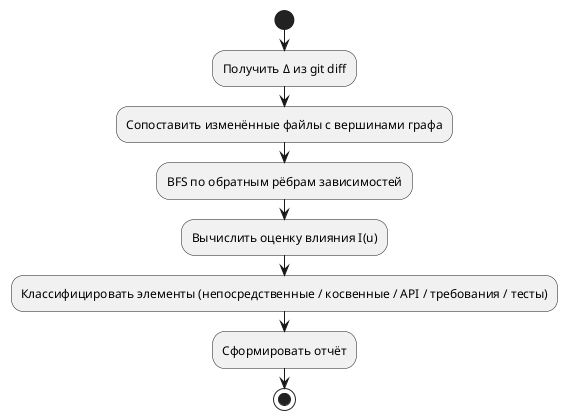
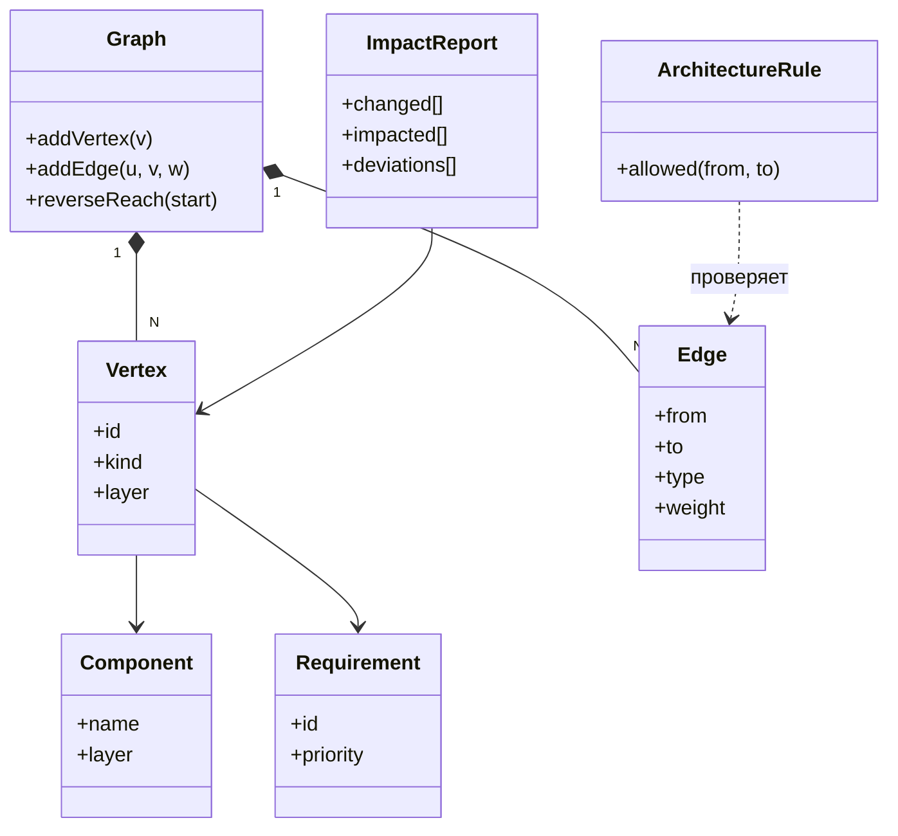
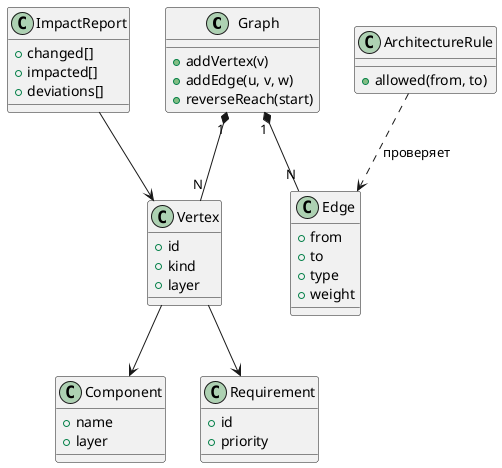

# SDD Project — Единый проектный отчёт

**Система:** Architecture Consistency & Impact Analyzer (ACIA)

**Дисциплина:** Современные проблемы программной инженерии (1 семестр)

**Методология разработки:** Specification-Driven Development (SDD)

**AI-агент:** OpenCode · **LLM-модель:** DeepSeek 4 Pro

**Назначение документа:** сводный проектный отчёт, объединяющий концепцию ВКР, анализ предметной области, требования, формальную модель, архитектуру, UML, технологический стек, организацию разработки и методику SDD. Фундамент для последующей разработки ACIA.

---

> **Статус и соглашения.** Настоящий отчёт описывает *проектируемую* систему. Ни одна из описываемых функций ACIA на момент написания отчёта не реализована. Утверждения о существующих технологиях и инструментах опираются на официальную документацию и общедоступные источники (приведены в тексте); проектные решения ACIA — авторские, помечены как «предположение»/«проектное решение». Там, где информации недостаточно для однозначного выбора, перечислены альтернативы и явно указаны допущения. Характеристики OpenCode и DeepSeek описываются только в объёме, подтверждённом их документацией.

---

## Содержание

1. [Видение продукта](#1-видение-продукта)
2. [Тема, цель и актуальность разработки](#2-тема-цель-и-актуальность-разработки)
3. [Анализ существующих решений и конкурентов](#3-анализ-существующих-решений-и-конкурентов)
4. [Функциональные и нефункциональные требования](#4-функциональные-и-нефункциональные-требования)
5. [Математическая модель и алгоритмы](#5-математическая-модель-и-алгоритмы)
6. [UML-моделирование](#6-uml-моделирование)
7. [Системный уровень разработки](#7-системный-уровень-разработки)
8. [Архитектура системы](#8-архитектура-системы)
9. [Технологический стек](#9-технологический-стек)
10. [Организация разработки и Git](#10-организация-разработки-и-git)
11. [Specification-Driven Development (SDD)](#11-specification-driven-development-sdd)
12. [Выбор LLM-моделей для выполнения работы](#12-выбор-llm-моделей-для-выполнения-работы)
13. [План разработки MVP](#13-план-разработки-mvp)
14. [Риски и ограничения](#14-риски-и-ограничения)
15. [Заключение](#15-заключение)
16. [Приложение: Архитектурные решения (ADR)](#16-приложение-архитектурные-решения-adr)
17. [Источники](#17-источники)

---

## 1. Видение продукта

### 1.1. Проблема

В процессе развития ПО исходный код, архитектурная документация, технические требования и принятые архитектурные решения постепенно расходятся («архитектурный дрейф»). Изменение одного компонента может незаметно затронуть другие модули, интерфейсы, требования и тесты. Разработчики не всегда могут своевременно оценить полный масштаб изменений, а рост AI-генерируемого кода усиливает риск неконтролируемых отклонений.

### 1.2. Идея

ACIA превращает архитектурную спецификацию в **исполняемый артефакт** процесса разработки. Система строит ориентированный граф зависимостей из исходного кода, сопоставляет его с формализованной спецификацией и отвечает на два ключевых вопроса:

1. Соответствует ли код задуманной архитектуре?
2. На что повлияет конкретное изменение кода (компоненты, API, требования, тесты)?

### 1.3. Ключевые ценности

- **Единая модель** «требования ↔ компоненты ↔ код ↔ тесты» в одном графе.
- **Детерминированный анализ** как основа (статический анализ, графовые алгоритмы, формальные правила); LLM — только опциональная интерпретация.
- **Контроль дрейфа** в CI: нарушение архитектурных ограничений блокирует слияние.
- **Living Documentation**: актуальные диаграммы и черновики документации с обязательным подтверждением человеком.
- **Методика SDD**: спецификация управляет разработкой, а не наоборот.

### 1.4. Пользователи

Архитекторы, ведущие разработчики, разработчики, QA-инженеры, руководители проектов.

### 1.5. Границы MVP

- Один язык (Go), CLI-интерфейс, офлайн-хранилище (файлы/SQLite) с переходом на PostgreSQL.
- Анализ статической структуры и зависимостей; без динамического анализа.
- LLM опциональна и не является обязательным механизмом анализа.

### 1.6. Отличия от конкурентов

Не «ещё один статический анализатор», а связка формальной спецификации с графом зависимостей и транзитивным Change Impact Analysis в едином цикле SDD (подробнее — Раздел 3).

### 1.7. Критерий успеха MVP

Для заданного Go-репозитория и архитектурной спецификации ACIA находит нарушения ограничений и формирует отчёт о влиянии изменения за разумное время, с детерминированными и воспроизводимыми результатами.

---

## 2. Тема, цель и актуальность разработки

### 2.1. Формулировка темы ВКР

**Тема:** «Методы и средства автоматизированного контроля согласованности архитектуры программного обеспечения с исходным кодом и оценки влияния изменений с применением Specification-Driven Development».

### 2.2. Цель разработки

Разработать программную систему ACIA, которая автоматизирует выявление расхождений между архитектурной спецификацией (требованиями, архитектурными ограничениями, описаниями компонентов и решениями ADR) и фактической реализацией (исходным кодом), а также позволяет оценивать влияние изменений кода на компоненты, интерфейсы, требования и тесты.

### 2.3. Объект и предмет исследования

- **Объект исследования** — процесс сопровождения и эволюции программного обеспечения, в котором исходный код, архитектурная документация и требования постепенно расходятся.
- **Предмет исследования** — методы, модели и алгоритмы статического анализа кода, построения ориентированного графа зависимостей, контроля архитектурных ограничений и оценки влияния изменений (Change Impact Analysis).

### 2.4. Актуальность проблемы

В процессе развития ПО накапливается «архитектурный дрейф» (architecture drift): реальная структура кода перестаёт соответствовать документированной архитектуре. Это приводит к росту затрат на сопровождение, увеличению числа дефектов при изменении кода и потере достоверности архитектурной документации. Параллельно растёт объём кода, генерируемого ИИ-ассистентами и агентами, что усиливает риск неконтролируемых изменений архитектуры. Существующие инструменты решают отдельные подзадачи (качество кода, правила слоёв, метрики, технический долг), но не объединяют в едином цикле *спецификация → код → оценка влияния → актуализация документации* с обязательной проверкой и подтверждением изменений человеком. ACIA закрывает эту нишу, делая спецификацию не статичным документом, а исполняемым артефактом процесса разработки.

### 2.5. Потенциальные пользователи

- **Архитекторы ПО** — контролируют соответствие реализации архитектурным ограничениям, актуализируют документацию.
- **Ведущие разработчики / tech leads** — оценивают масштаб влияния изменений перед ревью.
- **Разработчики** — получают автоматическое объяснение, что именно «сломает» их изменение.
- **QA-инженеры** — определяют, какие тесты и требования затронуты изменением.
- **Руководители проектов** — получают актуальную картину архитектурного здоровья.

### 2.6. Сценарии практического применения

1. CI-проверка: на каждый pull request запускается контроль архитектурных ограничений и оценка влияния изменения; нарушение блокирует слияние.
2. Рефакторинг: перед переносом модуля аналитик видит всех потребителей и транзитивные зависимости.
3. Аудит документации: система находит устаревшие описания и предлагает актуализацию (с подтверждением разработчиком).
4. Контроль AI-кода: код, сгенерированный агентом, проверяется на соответствие спецификации тем же механизмом, что и код человека.

### 2.7. Ожидаемый результат

Действующая система (MVP) на Go, которая:
- строит ориентированный граф зависимостей по Go-репозиторию (AST + git);
- сопоставляет его с архитектурной спецификацией и находит нарушения;
- выполняет Change Impact Analysis по набору изменений (git diff);
- формирует отчёт и «живую» документацию (Mermaid/PlantUML);
- опционально использует LLM для объяснения и рекомендаций, не подменяя детерминированный анализ.

### 2.8. Ограничения и границы проекта

- Первичная поддержка языка Go (расширение на другие языки — за счёт подключаемых адаптеров анализа).
- MVP реализуется одним разработчиком; анализ сосредоточен на статической структуре и зависимостях, без полноценного межпроцедурного dataflow и без динамического анализа.
- LLM не является обязательным компонентом анализа; изменения документации не применяются автоматически без подтверждения человеком.
- Система анализирует «снимок» репозитория (текущее состояние + история git), а не является runtime-монитором.

---

## 3. Анализ существующих решений и конкурентов

### 3.1. Методология сравнения

Сведения о конкурентах взяты из официальных сайтов и документации (на момент исследования):

- SonarQube — https://www.sonarsource.com/products/sonarqube/ и https://docs.sonarsource.com/
- ArchUnit — https://www.archunit.org/
- NDepend — https://www.ndepend.com/
- CodeScene — https://codescene.com/
- Structure101 — https://structure101.com/

Важное фактическое уточнение: Structure101 был приобретён компанией Sonar и **больше не продаётся как самостоятельный продукт** (сведения с structure101.com). Поэтому в таблице ниже он приведён как исторический/интегрируемый инструмент анализа структуры (DSM), а не как конкурирующее активное предложение.

### 3.2. Сводная таблица сравнения

| Критерий | SonarQube | ArchUnit | Structure101 | NDepend | CodeScene |
|---|---|---|---|---|---|
| Назначение | Платформа контроля качества, безопасности и верификации кода | Java-библиотека проверки архитектуры в unit-тестах | Анализ структуры кода, матрица зависимостей (DSM) | Статический анализ и метрики .NET, правила на C# LINQ | Поведенческий анализ кода и техдолга по истории Git |
| Основные возможности | SAST, taint-анализ, секреты, IaC, SCA, quality gates, отчёты | Правила зависимостей между пакетами/классами/слоями, поиск циклов | Dependency Structure Matrix, диаграммы слоёв, циклы | ~100 метрик, граф зависимостей, правила CQLinq, оценка долга | CodeHealth™, hot spots, приоритизация долга, AI-readiness |
| Анализ архитектуры | Да: «living map» из кода + фиксация дрейфа от задуманной структуры | Да, но только как код правил, написанных разработчиком | Да: визуализация структуры и слоёв | Да: граф и матрица зависимостей, правила | Косвенно: через метрики и hot spots, не формальная модель |
| Анализ зависимостей | Да (частично, через анализ структуры) | Да: прямые и циклические зависимости | Да: сильная сторона (DSM) | Да: граф и DSM | Косвенно |
| Оценка влияния изменений | Через quality gate и diff (новые issues), без формального транзитивного impact-модели | Нет | Нет | Есть diff от baseline и «новые issues» | Есть (по истории Git, hot spots), не транзитивный граф |
| Контроль соответствия спецификации | Частично: правила и quality gates, но спецификация не является моделью данных | Частично: правила жёстко закодированы в тестах | Нет | Частично: правила CQLinq | Нет |
| Генерация документации | Отчёты по стандартам (PDF), не «живая» арх. документация | Нет | Диаграммы структуры | Веб-отчёты | Отчёты и метрики |
| Использование AI | Да: AI CodeFix, Remediation/Hunter/Vortex-агенты, MCP | Нет | Нет | Да: NDepend.AI, MCP Server | Да: CodeHealth™ MCP, AI-рефакторинг |
| Ограничения | Архитектурная модель ограничена; не связывает требования-компоненты-тесты в одном графе | Только Java/.NET; правила вручную; нет оценки влияния | Продукт поглощён Sonar, не продаётся | Только .NET; коммерческая лицензия | Фокус на метриках и Git-истории, а не на формальной спецификации |

### 3.3. Ключевые выводы

1. **SonarQube** наиболее близок по направлению (у него уже есть выявление архитектурного дрейфа и AI-агенты), но архитектурная модель остаётся набором правил, а не полноценной машиночитаемой спецификацией, связывающей требования, компоненты, интерфейсы и тесты.
2. **ArchUnit** реализует идею «исполняемой архитектуры», но только для JVM и с правилами в виде кода, который поддерживает сам разработчик; нет графа как сущности и нет impact-анализа.
3. **NDepend** даёт мощный граф зависимостей и diff от baseline для .NET, но не имеет модели спецификации и транзитивной оценки влияния с классификацией затронутых элементов.
4. **CodeScene** уникален поведенческим анализом (история Git), но не является инструментом контроля соответствия спецификации.
5. **Structure101** — исторически сильный инструмент структурного анализа (DSM), но после приобретения Sonar не развивается как самостоятельный продукт.

### 3.4. Отличительные особенности и ниша ACIA

ACIA не претендует на роль «замены» перечисленных инструментов и не утверждает, что аналогов нет. Ниша ACIA — **связывание формальной спецификации с графом зависимостей в едином цикле SDD**:

- Единая модель данных: требования, архитектурные ограничения, компоненты, интерфейсы, тесты и код представлены как вершины и рёбра одного ориентированного графа, что позволяет выполнять транзитивный Change Impact Analysis с классификацией затронутых элементов (не только «новые issues», а именно: какие API/требования/тесты затронуты и почему).
- Спецификация как исполняемый артефакт: контроль соответствия реализован как проверка рёбер графа кода против разрешённых рёбер спецификации (а не как отдельные правила).
- Детерминированный анализ + опциональная AI-интерпретация: LLM не подменяет статический анализ, а лишь объясняет и приоритизирует результаты.
- Обязательное подтверждение человеком любых автоматических изменений документации.

---

## 4. Функциональные и нефункциональные требования

Полный каталог требований с уникальными идентификаторами.

### 4.1. Функциональные требования

#### FR-001 — Управление функциональными и нефункциональными требованиями
- **Приоритет:** Высокий
- **Описание:** хранение, создание, редактирование и версионирование функциональных и нефункциональных требований.
- **Входные данные:** описание требования, тип, приоритет, связи.
- **Ожидаемый результат:** требование сохранено в хранилище и доступно для трассировки.
- **Критерии приёмки:** требование можно создать/прочитать/обновить; идентификатор уникален; связи с кодом сохраняются.

#### FR-002 — Управление архитектурными ограничениями
- **Приоритет:** Высокий
- **Описание:** хранение ограничений в виде разрешённого отношения зависимостей между слоями/компонентами.
- **Входные данные:** список слоёв и разрешённых пар зависимостей.
- **Ожидаемый результат:** ограничения сохранены и применяются при проверке.
- **Критерии приёмки:** ограничение можно задать в конфигурации; при проверке используются именно заданные пары.

#### FR-003 — Управление описаниями компонентов и интерфейсов
- **Приоритет:** Высокий
- **Описание:** хранение описаний компонентов и их публичных интерфейсов, сопоставление с пакетами кода.
- **Входные данные:** имя компонента, слой, список пакетов, описание интерфейса.
- **Ожидаемый результат:** компонент и его интерфейсы зафиксированы.
- **Критерии приёмки:** компонент привязан к коду через функцию `layer(v)`; интерфейсы доступны для проверки.

#### FR-004 — Управление архитектурными решениями (ADR)
- **Приоритет:** Средний
- **Описание:** хранение и версионирование архитектурных решений в формате ADR.
- **Входные данные:** заголовок, статус, контекст, решение, последствия.
- **Ожидаемый результат:** ADR сохранён и привязан к спецификации.
- **Критерии приёмки:** ADR читается и изменяется по контролируемому процессу.

#### FR-005 — Импорт и анализ структуры Go-проекта (AST)
- **Приоритет:** Высокий
- **Описание:** обход исходного кода Go через AST, извлечение пакетов, файлов, типов, функций и импортов.
- **Входные данные:** путь к пакету/модулю репозитория.
- **Ожидаемый результат:** структура проекта извлечена в виде списка элементов кода.
- **Критерии приёмки:** для фикстур извлекаются все `import`, `type`, `func`; вложенные пакеты обрабатываются рекурсивно.

#### FR-006 — Построение ориентированного графа зависимостей
- **Приоритет:** Высокий
- **Описание:** формирование типизированного графа $G=(V,E)$ из извлечённых элементов.
- **Входные данные:** элементы кода и их отношения.
- **Ожидаемый результат:** граф с вершинами и рёбрами типов `dep`, `sat`, `con`, `test`.
- **Критерии приёмки:** рёбра зависимостей корректно ориентированы; граф сохраняется.

#### FR-007 — Сопоставление архитектурной модели с реализацией
- **Приоритет:** Высокий
- **Описание:** приведение элементов кода к логическим компонентам (`layer(v)`) и сопоставление со спецификацией.
- **Входные данные:** граф кода, спецификация.
- **Ожидаемый результат:** каждому элементу кода сопоставлен слой/компонент.
- **Критерии приёмки:** элементы без сопоставления помечаются и попадают в отчёт.

#### FR-008 — Обнаружение нарушений архитектурных ограничений
- **Приоритет:** Высокий
- **Описание:** поиск рёбер $(u,v)$, для которых $(layer(u),layer(v))\notin A$, и циклов между слоями.
- **Входные данные:** граф, разрешённое отношение $A$.
- **Ожидаемый результат:** список отклонений с указанием ребра и слоёв.
- **Критерии приёмки:** контрольный пример с нарушением даёт ожидаемое отклонение.

#### FR-009 — Обнаружение несоответствий «требования ↔ код»
- **Приоритет:** Средний
- **Описание:** выявление требований без трассировки к коду и кода без требований.
- **Входные данные:** отношения трассировки $E_{sat}$.
- **Ожидаемый результат:** список «непокрытых» требований.
- **Критерии приёмки:** требование без связи с кодом помечается.

#### FR-010 — Обнаружение изменений по git diff
- **Приоритет:** Высокий
- **Описание:** определение изменённых файлов/элементов между ревизиями.
- **Входные данные:** базовая и целевая ревизии (или рабочий каталог).
- **Ожидаемый результат:** множество $\Delta$ изменённых вершин.
- **Критерии приёмки:** изменения корректно сопоставляются с вершинами графа.

#### FR-011 — Change Impact Analysis (транзитивное замыкание)
- **Приоритет:** Высокий
- **Описание:** вычисление затронутых элементов через обратную достижимость по рёбрам зависимостей.
- **Входные данные:** $\Delta$, граф $G$.
- **Ожидаемый результат:** множество $Impact(\Delta)$ с оценками влияния.
- **Критерии приёмки:** для контрольного изменения определяются прямые и косвенные потребители.

#### FR-012 — Классификация затронутых элементов
- **Приоритет:** Средний
- **Описание:** разбиение затронутых элементов на «непосредственные», «косвенные», «API/требования/тесты».
- **Входные данные:** результат impact-анализа.
- **Ожидаемый результат:** классифицированный список.
- **Критерии приёмки:** классы определяются по правилам из Раздела 5 отчёта.

#### FR-013 — Формирование отчёта о влиянии изменений
- **Приоритет:** Высокий
- **Описание:** человекочитаемый (markdown) и машиночитаемый (JSON) отчёт.
- **Входные данные:** результаты анализа.
- **Ожидаемый результат:** отчёт с отклонениями и влиянием.
- **Критерии приёмки:** отчёт читается; JSON корректен; exit-код отражает статус.

#### FR-014 — Генерация архитектурных диаграмм
- **Приоритет:** Средний
- **Описание:** генерация диаграмм Mermaid/PlantUML из графа.
- **Входные данные:** граф, настройки.
- **Ожидаемый результат:** файлы диаграмм.
- **Критерии приёмки:** диаграммы визуализируют компоненты и зависимости.

#### FR-015 — Выявление устаревшей документации
- **Приоритет:** Низкий
- **Описание:** сопоставление документации с реализацией и выявление расхождений.
- **Входные данные:** граф, документация.
- **Ожидаемый результат:** список устаревших описаний.
- **Критерии приёмки:** расхождения помечаются, изменения не применяются автоматически.

#### FR-016 — AI-интерпретация отклонений и рекомендаций (опционально)
- **Приоритет:** Низкий
- **Описание:** объяснение отклонений и формирование рекомендаций через LLM.
- **Входные данные:** список отклонений, контекст.
- **Ожидаемый результат:** текст-объяснение/рекомендация, помеченный как предложение.
- **Критерии приёмки:** результат требует подтверждения разработчиком; анализ работает без LLM.

### 4.2. Нефункциональные требования

| ID | Категория | Требование | Критерий |
|---|---|---|---|
| NFR-01 | Производительность | Анализ проекта <100 тыс. LOC ≤ 60 с | Замер на репрезентативной фикстуре |
| NFR-02 | Масштабируемость | Модули изолированы; возможно выделение сервисов | Чистые границы модулей, инверсия зависимостей |
| NFR-03 | Безопасность | Ключи LLM вне репозитория; анализ локально | Нет обязательной отправки кода во внешние сервисы |
| NFR-04 | Расширяемость | Новые языки/LLM подключаются адаптерами | Новый адаптер без изменения ядра |
| NFR-05 | Надёжность | Детерминированные результаты | Повторный запуск даёт тот же результат |
| NFR-06 | Удобство | CLI с понятным выводом | Справка и коды возврата |
| NFR-07 | Сопровождаемость | Модульность, тесты ключевых алгоритмов | Покрытие алгоритмов юнит-тестами |

### 4.3. Пользовательские сценарии (Use Cases)

- **UC-01 Импорт репозитория:** разработчик указывает путь; ACIA строит граф.
- **UC-02 Задание спецификации:** архитектор описывает слои и разрешённые зависимости.
- **UC-03 Проверка соответствия:** запуск проверки; отчёт об отклонениях.
- **UC-04 Оценка влияния:** разработчик запускает анализ по diff; отчёт о затронутых элементах.
- **UC-05 Генерация документации:** формирование диаграмм и черновиков.
- **UC-06 AI-объяснение:** опциональный запрос интерпретации отклонения.

### 4.4. Разделение на MVP и перспективы

**MVP:** FR-001, FR-002, FR-003, FR-005, FR-006, FR-007, FR-008, FR-010, FR-011, FR-013.

**Перспективные:** FR-004, FR-009, FR-012, FR-014, FR-015, FR-016, веб-интерфейс, поддержка других языков, полная интеграция PostgreSQL.

---

## 5. Математическая модель и алгоритмы

### 5.1. Модель: ориентированный граф зависимостей

Ядром системы является ориентированный граф

$$G = (V, E),$$

где вершины и рёбра типизированы.

**Типы вершин** (`V = V_{code} ∪ V_{req} ∪ V_{arch} ∪ V_{test} ∪ V_{ext}`):

- $V_{code}$ — элементы кода: модуль (пакет), файл, тип/структура, функция/метод;
- $V_{req}$ — требования (функциональные и нефункциональные);
- $V_{arch}$ — архитектурные ограничения и ADR;
- $V_{test}$ — тестовые артефакты;
- $V_{ext}$ — внешние зависимости (модули сторонних библиотек).

**Типы рёбер** (`E = E_{dep} ∪ E_{sat} ∪ E_{con} ∪ E_{test}`):

- $E_{dep}$ — отношения зависимости: `imports`, `calls`, `depends-on`, `implements` (между элементами кода);
- $E_{sat}$ — отношения трассировки: `satisfies`, `traces-to` (связывают код с требованиями);
- $E_{con}$ — отношения ограничения: `constrained-by`, `allowed-to-use` (связывают элементы кода с архитектурными правилами);
- $E_{test}$ — отношения тестирования: `tests`, `covers` (связывают тесты с кодом).

Каждое ребро $e \in E$ несёт вес $w(e) \ge 0$, отражающий «силу» связи (например, прямой импорт весит меньше, чем вызов интерфейса, критичного для публичного API). Веса задаются конфигурацией и являются проектным допущением.

### 5.2. Представление компонентов и архитектурных ограничений

Архитектурная спецификация формализуется как **разрешённое отношение зависимостей** между логическими слоями/компонентами:

$$A \subseteq L \times L,$$

где $L$ — множество логических компонентов (слоёв). Например, для слоёв `domain`, `application`, `infrastructure`, `interfaces` разрешённое отношение может содержать пару `(application, domain)`, но не `(domain, infrastructure)`.

Функция `layer(v)` сопоставляет элемент кода $v \in V_{code}$ логическому компоненту $l \in L$.

**Нарушение архитектурного ограничения** — это ребро $(u, v) \in E_{dep}$ такое, что

$$(layer(u), layer(v)) \notin A.$$

Дополнительно проверяется отсутствие циклов между логическими компонентами (запрет циклических зависимостей на уровне слоёв), если это задано ограничением.

### 5.3. Связь требований, компонентов, кода и тестов

Согласованность моделируется через отношения трассировки $E_{sat}$ и $E_{test}$:

- требование $r$ «покрывается», если существует хотя бы один путь $r \to \dots \to v$ в подграфе трассировки, где $v \in V_{code}$;
- тест $t$ «покрывает» код $v$, если $(t, v) \in E_{test}$.

Это позволяет при изменении элемента кода определить затронутые требования и тесты.

### 5.4. Алгоритм Change Impact Analysis

**Вход:** множество изменённых вершин $\Delta \subseteq V_{code}$ (получается из git diff путём сопоставления изменённых файлов с вершинами графа).

**Шаг 1 — непосредственные зависимости.** Для каждого $v \in \Delta$ находятся прямые потребители: вершины $u$, для которых существует ребро $u \to v \in E_{dep}$ (входящие рёбра в направлении зависимости).

**Шаг 2 — транзитивное замыкание.** Множество затронутых элементов определяется обратной достижимостью в подграфе зависимостей $E_{dep}$:

$$Impact(\Delta) = \{ u \in V \mid \exists\, v \in \Delta : v \leadsto^* u \text{ по обратным рёбрам } E_{dep} \}.$$

Практически это BFS/DFS от $\Delta$ по входящим рёбрам с релаксацией весов (алгоритм Дейкстры/модифицированный BFS), что даёт и множество, и степень влияния.

**Шаг 3 — оценка степени влияния.** Для каждого $u \in Impact(\Delta)$ вычисляется «оценка влияния» $I(u)$ как минимальный по всем путям суммарный вес (или расстояние с учётом весов):

$$I(u) = \min_{v \in \Delta} d(v, u),$$

где $d(v,u)$ — минимальная стоимость пути по обратным рёбрам. Чем меньше $I(u)$, тем сильнее влияние.

**Шаг 4 — классификация.** Элементы $u$ разбиваются на классы:

- **непосредственно затронутые** — $u$ связан с $\Delta$ прямым ребром;
- **косвенно затронутые** — $u$ достижим только через транзитивные пути;
- **затронутые API/требования/тесты** — $u \in V_{req} \cup V_{test}$ либо публичный интерфейс, достижимый из $Impact(\Delta)$.

### 5.5. Алгоритм определения архитектурных отклонений

**Вход:** граф кода $G$, разрешённое отношение $A$, функция `layer`.

**Алгоритм:**
1. Построить $E_{dep}$ по AST и карте пакетов.
2. Для каждого $(u, v) \in E_{dep}$ проверить $(layer(u), layer(v)) \in A$; при невыполнении зафиксировать отклонение.
3. Для проверки циклических зависимостей слоёв — применить поиск циклов (DFS с раскраской или алгоритм Тарьяна для компонент сильной связности) на графе слоёв.
4. Сформировать список отклонений с указанием ребра, слоёв и контекста.

### 5.6. Детерминированное и AI-зависимое

- **Детерминированно:** построение графа, поиск зависимостей, транзитивное замыкание, проверка ограничений, поиск циклов — всё это чисто алгоритмические операции и не требует LLM.
- **AI (опционально):** объяснение причины отклонения, приоритизация отклонений по бизнес-важности, формулировка рекомендаций и черновиков изменений документации. Каждое AI-предложение требует подтверждения разработчиком.

Введённые формулы описывают именно ту часть системы, которая будет реализована детерминированно; математический аппарат вводится только там, где он непосредственно используется (граф зависимостей, транзитивное замыкание, проверка принадлежности разрешённому отношению).

---

## 6. UML-моделирование

Ниже — диаграммы проекта. Исходники в формате PlantUML находятся в `specs/architecture/diagrams/`; здесь приведены эквивалентные диаграммы в Mermaid и PlantUML-исходники.

### 6.1. Use Case Diagram





### 6.2. Component Diagram





### 6.3. Sequence Diagram — сценарий анализа PR





### 6.4. Activity Diagram — Change Impact Analysis

```mermaid
flowchart TD
    Start([Начало]) --> Diff[Получить Δ из git diff]
    Diff --> Map[Сопоставить файлы с вершинами графа]
    Map --> BFS[BFS по обратным рёбрам зависимостей]
    BFS --> Score[Вычислить оценку влияния I(u)]
    Score --> Class[Классифицировать элементы]
    Class --> Report[Сформировать отчёт]
    Report --> End([Конец])
```



### 6.5. Class Diagram — доменные сущности





---

## 7. Системный уровень разработки

ACIA рассматривается как отдельная система («чёрный ящик») в модели Input — Process — Output.

### 7.1. Входная информация и источники

| Вход | Источник | Назначение |
|---|---|---|
| Исходный код (репозиторий) | Git-репозиторий (локальный клон) | Основа для статического анализа и графа |
| История изменений | Git (commits, diff) | Определение $\Delta$ для impact-анализа |
| Архитектурная спецификация | Файлы `specs/` (требования, ограничения, ADR) | Эталон для контроля соответствия |
| Параметры запуска | CLI-аргументы, конфигурация | Управление режимом и порогами |
| Опционально: промпт к LLM | Разработчик/API | Запрос объяснения/рекомендации |

### 7.2. Выходная информация и получатели

| Выход | Получатель | Назначение |
|---|---|---|
| Отчёт об отклонениях | Архитектор, разработчик, CI | Фиксация нарушений ограничений |
| Отчёт о влиянии изменения | Разработчик, tech lead, QA | Масштаб и классификация изменений |
| Архитектурные диаграммы | Архитектор, команда | Актуализированная документация |
| Черновики изменений документации | Архитектор (на подтверждение) | Предложения актуализации |
| Статус проверки (exit code) | CI/CD | Блокировка/пропуск слияния |

### 7.3. Границы ответственности

ACIA **не** изменяет код и **не** модифицирует документацию автоматически; она читает репозиторий, анализирует и формирует результаты. Внешние системы: Git (источник), опционально LLM-провайдер (только для интерпретации), опционально CI/CD (потребитель статуса).

### 7.4. Модель Input — Process — Output

```
Вход                       Процесс                        Выход
─────────────────────────  ─────────────────────────────  ──────────────────────────
Код (git)          ──────►  Статический анализ (AST)   ──►  Граф зависимостей
История (diff)     ──────►  Построение графа           ──►  Отклонения от архитектуры
Спецификация       ──────►  Проверка ограничений       ──►  Отчёт о влиянии изменений
Параметры          ──────►  Change Impact Analysis     ──►  Диаграммы (Mermaid/PlantUML)
Промпт LLM (опц.)  ──────►  AI-интерпретация (опц.)    ──►  Черновики документации
```

---

## 8. Архитектура системы

### 8.1. Выбор укрупнённой архитектуры

- **Клиент-серверная модель** — принята как способ доступа (CLI/API как клиент к ядру), но не как единственный принцип организации кода.
- **Модульный монолит** — **принят** как основной вариант для MVP: один процесс, но жёстко разделённые модули с изолированными границами.
- **Гексагональная архитектура** — **принята** как внутренняя структура ядра (домен + порты + адаптеры), что упрощает тестирование и замену адаптеров (Git, БД, LLM).
- **Микросервисы** — **отклонены** для MVP: для однопользовательского анализа они дают издержки оркестрации и распределённого состояния без реального выигрыша.

**Обоснование:** модульный монолит с гексагональной организацией сочетает простоту развёртывания (один процесс) с возможностью позднее выделить модули в отдельные сервисы без изменения доменной модели (инверсия зависимостей через порты).

### 8.2. Основные модули и их ответственность

| Модуль | Ответственность |
|---|---|
| `interfaces` (CLI/HTTP) | Приём команд, вывод отчётов, exit-коды |
| `spec` (Specification) | Хранение и валидация требований, ограничений, ADR |
| `analysis` (Code Analysis) | AST-анализ Go-кода, извлечение зависимостей |
| `graph` (Graph Engine) | Модель графа, транзитивное замыкание, поиск циклов |
| `conformance` (Conformance) | Сопоставление графа со спецификацией, поиск отклонений |
| `impact` (Impact Analyzer) | Change Impact Analysis и классификация |
| `docgen` (Documentation) | Генерация диаграмм и черновиков документации |
| `llm` (LLM Adapter) | Опциональная интерпретация через DeepSeek 4 Pro |
| `repo` (Repository Store) | Персистентность (PostgreSQL) и/или файловое хранилище |
| `git` (Git Adapter) | Работа с репозиторием, diff, история |

### 8.3. Взаимодействия и потоки данных

1. `interfaces` получает команду и вызывает соответствующий сервис.
2. `analysis` читает код через `git`/файловую систему, строит AST и передаёт вершины/рёбра в `graph`.
3. `conformance` берёт граф и спецификацию из `spec`, вычисляет отклонения.
4. `impact` берёт diff из `git` и граф из `graph`, выполняет замыкание.
5. `docgen` формирует отчёты и диаграммы; `llm` (если включён) дополняет объяснениями.
6. Результаты сохраняются через `repo` и возвращаются в `interfaces`.

### 8.4. Внутренние и внешние интерфейсы

- **Внутренние (порты):** `SourceReader`, `DiffReader`, `GraphStore`, `SpecStore`, `LLMClient`, `DocumentRenderer`.
- **Внешние:** Git (чтение), PostgreSQL (хранение), LLM-провайдер (HTTP API DeepSeek), файловая система (конфиг и артефакты), CI/CD (exit-коды и машиночитаемый JSON-вывод).

### 8.5. Взаимодействие с LLM и Git

- **LLM:** изолированный адаптер; вызывается только для интерпретации/рекомендаций, результат помечается как «предложение» и не меняет состояние без подтверждения.
- **Git:** только чтение (clone/fetch, log, diff, blame); ACIA не делает push и не создаёт автоматических коммитов.

### 8.6. Хранение данных

Основное хранилище — PostgreSQL (см. Раздел 9 и ADR-0003). Для офлайн-режима MVP допустимо хранение графа и спецификации в локальном файловом формате (SQLite/файлы), что снижает порог запуска.

### 8.7. Расширяемость

Добавление нового языка анализа сводится к новому адаптеру `SourceReader`, реализующему порт анализа; добавление нового LLM-провайдера — к новому адаптеру `LLMClient`; изменение правил контроля — к изменению данных спецификации, а не кода ядра.

---

## 9. Технологический стек

### 9.1. Язык backend — Go

**Выбор:** Go (Golang).

**Обоснование:**
- Нативные возможности статического анализа: `go/parser`, `go/ast`, `go/types` — разбор исходного кода без внешних парсеров, что прямо покрывает задачу FR-005.
- Статическая типизация и простота — подходят для одного разработчика и снижают риск ошибок при работе с графовыми структурами.
- Хорошая поддержка работы с Git (`go-git`) и контейнеризации.

**Альтернативы и почему отклонены:**
- *Python* — удобен для прототипа, но слабее по нативному AST Go-кода и производительности.
- *Java* — зрелый инструментарий анализа, но тяжелее для MVP и требует большей инфраструктуры.

### 9.2. Frontend

**Выбор:** на этапе MVP — CLI; веб-интерфейс отложен.

**Обоснование:** основной потребитель результатов — CI и разработчик в терминале. Веб-панель добавляет затраты без влияния на ядро анализа. При необходимости — простая панель (серверная генерация HTML + Mermaid на клиенте).

### 9.3. СУБД — PostgreSQL (основная), SQLite/файлы для офлайн MVP

**Обоснование:** PostgreSQL обеспечивает целостность и транзакционность для хранения спецификаций, графа и результатов; соответствует заданию. Для минимального порога запуска MVP допускается SQLite/файловое хранилище за тем же портом `GraphStore`/`SpecStore`.

**Альтернативы:** *MySQL* — менее строгая реализация стандартов; *SQLite* — ограничение конкурентной записи; *графовые БД (Neo4j)* — избыточно для MVP.

### 9.4. Работа с Git

**Выбор:** `go-git` (чистый Go) с опцией вызова `git` CLI.

**Обоснование:** чтение истории, `diff`, `blame` без внешних бинарников; при необходимости — CLI для расширенной функциональности.

### 9.5. Статический анализ Go-кода

**Выбор:** стандартные `go/parser`, `go/ast`, `go/types`; опционально `golang.org/x/tools/go/packages`.

**Обоснование:** встроенный и точный разбор; `go/packages` упрощает разрешение импортов между пакетами.

### 9.6. Графовые алгоритмы

**Выбор:** `gonum/graph` или собственная легковесная реализация.

**Обоснование:** требуется транзитивное замыкание (обратная достижимость), поиск циклов (Тарьян/DFS), кратчайшие пути с весами. `gonum/graph` покрывает это; при минимизации зависимостей — собственная реализация.

### 9.7. Визуализация диаграмм

**Выбор:** Mermaid (основной), PlantUML (опционально).

**Обоснование:** текстовое представление легко генерировать из графа, хранить в Git и рендерить в markdown/CI.

### 9.8. Тестирование

**Выбор:** стандартный `testing` + `testify`.

**Обоснование:** широкое распространение, ассерты и моки.

### 9.9. CI/CD

**Выбор:** GitHub Actions (или GitLab CI).

**Обоснование:** автоматизация `lint` (`golangci-lint`), `test`, `build` и проверки согласованности.

### 9.10. Контейнеризация

**Выбор:** Docker.

**Обоснование:** воспроизводимое окружение для запуска анализа.

### 9.11. Сводная таблица выбора

| Категория | Выбор | Обоснование |
|---|---|---|
| Язык backend | Go | Нативный AST, статическая типизация, работа с Git, один разработчик |
| Frontend | CLI (веб отложен) | Потребитель — CI/терминал; UI не блокирует ядро |
| СУБД | PostgreSQL (+SQLite офлайн) | Целостность, транзакционность; простой старт офлайн |
| Git | `go-git` (+git CLI) | Чтение истории/diff без внешних бинарников |
| Статический анализ | `go/parser`, `go/ast`, `go/types` | Встроенный точный разбор Go |
| Графы | `gonum/graph` (или своя) | Замыкание, циклы, кратчайшие пути |
| Визуализация | Mermaid / PlantUML | Текстовая генерация, интеграция в Git/CI |
| Тестирование | `testing` + `testify` | Простота, ассерты, моки |
| CI/CD | GitHub Actions / GitLab CI | Автоматизация проверок |
| Контейнеризация | Docker | Воспроизводимость |
| Инструменты разработки | OpenCode + DeepSeek 4 Pro | Методика SDD (Разделы 11–12) |

> Замечание: конкретные версии и окончательный выбор библиотек уточняются в ходе реализации и фиксируются в `go.mod` и ADR.

---

## 10. Организация разработки и Git

### 10.1. Структура репозитория

```
acia/
├── cmd/acia/            # точка входа CLI
├── internal/            # домен и сервисы
│   ├── spec/
│   ├── analysis/
│   ├── graph/
│   ├── conformance/
│   ├── impact/
│   ├── docgen/
│   └── llm/
├── adapters/            # Git, DB, LLM, file adapters
├── specs/               # спецификации (продукт, архитектура, ADR)
├── docs/                # отчёты и документация
├── .github/workflows/   # CI
└── go.mod
```

### 10.2. Стратегия ветвления

- **`main`** — стабильная ветка, защищена; слияние только через PR с прохождением CI.
- **`develop`** — интеграционная ветка (опционально для MVP).
- **`feature/<id>`** — ветки функциональности (по одному требованию/функции).
- **`docs/<topic>`** — ветки изменений документации и спецификаций.

### 10.3. Правила коммитов

Используются Conventional Commits: `feat:`, `fix:`, `docs:`, `refactor:`, `test:`, `chore:` с привязкой к идентификатору требования/ADR (например, `feat(FR-005): import Go AST`).

### 10.4. Порядок code review

1. Любое изменение — через PR.
2. CI выполняет линт, тесты, сборку и (при наличии) проверку согласованности.
3. Изменения архитектуры и требований проходят обязательное ревью архитектора и фиксируются ADR.

### 10.5. Контролируемое изменение спецификаций

Изменение `specs/` (требования, архитектура, ADR) — это отдельный процесс: PR с описанием мотивации, ревью, обновление связанных ADR, проверка согласованности всех зависимых документов. Изменения спецификации не смешиваются с изменениями кода в одном PR без явного обоснования.

---

## 11. Specification-Driven Development (SDD)

> Центральный методический раздел. SDD — не просто упоминание в отчёте, а основная методология разработки ACIA.

### 11.1. Определение

Specification-Driven Development — методология, при которой **формальная спецификация является единственным источником истины**, а код, тесты и документация выводятся из неё и проверяются на соответствие ей.

Отличие от AI-assisted coding и вайб-кодинга: в SDD требования и контракты фиксируются **до** написания кода, а проверка соответствия автоматизирована.

### 11.2. Отличие SDD от AI-assisted coding и вайб-кодинга

| Критерий | Вайб-кодинг | AI-assisted coding | SDD |
|---|---|---|---|
| Источник истины | Настроение/разговор с LLM | Текстовый запрос | Формальная спецификация |
| Проверяемость | Слабая | Частичная (тесты ad hoc) | Автоматическая (приёмка по спецификации) |
| Управление изменениями | Неявное | Неявное | Явное (спецификация → код → проверка → актуализация) |
| Риск дрейфа архитектуры | Высокий | Средний | Низкий (контроль на каждом шаге) |

### 11.3. Процесс SDD (10 шагов)

1. Формирование продуктовой спецификации.
2. Декомпозиция требований на функциональные возможности.
3. Создание спецификаций отдельных функций (контракт + acceptance criteria).
4. Проектирование архитектуры на основании требований.
5. Формирование технических контрактов и интерфейсов.
6. Реализация функциональности AI-агентом на основании утверждённых спецификаций.
7. Проверка реализации на соответствие спецификациям.
8. Создание и выполнение тестов по acceptance criteria.
9. Анализ влияния изменений на существующую систему.
10. Актуализация спецификаций и архитектурной документации при необходимости.

### 11.4. Роли в процессе SDD

#### Разработчик (человек)
- Формирует и утверждает спецификации.
- Принимает архитектурные решения (ADR).
- Проводит ревью и приёмку кода.
- Подтверждает изменения документации.
- Определяет acceptance criteria и запускает контрольные проверки.

#### AI-агент (OpenCode + DeepSeek 4 Pro)
- Декомпозиция требований и черновики спецификаций функций.
- Реализация кода по утверждённой спецификации.
- Генерация тестов по acceptance criteria.
- Черновики документации и диаграмм.

### 11.5. Передача контекста агенту

Агент получает контекст из файлов репозитория: `specs/`, `docs/`, `AGENTS.md`, а не из импровизированных промптов. В контекст входят: продуктовая спецификация, каталог требований, спецификация функции, архитектурное описание и ADR, технические контракты, правила генерации кода.

### 11.6. Следование спецификациям и проверка результата

1. У каждой функции есть спецификация с acceptance criteria.
2. Агент пишет код и тесты строго по контракту.
3. CI запускает тесты, линтер, проверку согласованности.
4. Несоответствие возвращается агенту на доработку.

### 11.7. Контроль архитектурной целостности

- Изменение архитектуры — только через ADR и ревью архитектора.
- Агенту запрещено менять `specs/architecture/` без отдельного разрешения.
- CI-проверка отклонений блокирует слияние.
- Запрещено менять публичные интерфейсы без обновления контракта.

### 11.8. Структура SDD-файлов

```
specs/
├── product/requirements.md          # каталог требований (FR/NFR + acceptance criteria)
├── product/use-cases.md             # сценарии
├── architecture/overview.md         # архитектурное описание
├── architecture/diagrams/           # UML-диаграммы
├── architecture/decisions/          # ADR
└── functions/<function-id>.md       # спецификация отдельной функции (контракт + acceptance criteria)
```

### 11.9. Пример жизненного цикла функции

Функция FR-005 «Импорт Go-пакета и извлечение зависимостей»:

1. **Требование:** FR-005 — анализ структуры Go-проекта через AST.
2. **Спецификация функции:** вход — путь к пакету; выход — список элементов и рёбер зависимостей; acceptance criteria — корректная обработка `import`, `func`, `type`, рекурсивный обход вложенных пакетов.
3. **Архитектурное решение:** адаптер `analysis` реализует порт `SourceReader`; зависимости только `graph` → ядро.
4. **Реализация:** агент пишет `internal/analysis/*.go` по спецификации.
5. **Тесты:** unit-тесты на фикстурах пакетов; проверка, что граф содержит ожидаемые рёбра.
6. **Проверка соответствия:** CI запускает тесты + проверку архитектурных ограничений; результат сверяется с acceptance criteria.

### 11.10. SDD как предмет системы

Важно: ACIA *реализуется* по SDD, и одновременно сама система *автоматизирует* часть SDD-цикла (шаги 7–10): проверку соответствия кода спецификации, оценку влияния изменений и актуализацию документации. Таким образом, методология и продукт образуют единое целое: система проверяет тот же процесс, по которому она сама разрабатывается.

---

## 12. Выбор LLM-моделей для выполнения работы

> Раздел отвечает на требование дисциплины «Выбор и использование AI-агента, LLM» и на требование задания обосновать роль моделей в SDD.

### 12.1. Зачем LLM нужна в SDD

LLM используется в двух контурах:

1. **Контур разработки (внешний):** AI-агент OpenCode на модели DeepSeek 4 Pro выполняет шаги 2, 3, 6, 8 и частично 10 процесса SDD — декомпозиция требований, черновики спецификаций функций, генерация кода и тестов, черновики документации.
2. **Контур продукта (внутренний, опционально):** адаптер `llm` в ACIA (FR-016) объясняет архитектурные отклонения и формирует рекомендации. Здесь LLM не выполняет анализ, а только интерпретирует его детерминированные результаты.

### 12.2. Критерии выбора модели

Для задач SDD модель выбирается по следующим критериям (приоритет сверху вниз):

| Критерий | Почему важен для SDD |
|---|---|
| Следование инструкциям | Модель должна строго держаться контракта функции и acceptance criteria, не «фантазировать» сверх спецификации |
| Качество генерации Go-кода | Основной язык реализации — Go; ошибки кодогенерации дорого обходятся |
| Объём контекстного окна | Нужно передавать спецификации + ADR + релевантный код одновременно |
| Точность и воспроизводимость | Код должен компилироваться и проходить тесты с первого-второго прохода |
| Стоимость инференса | SDD предполагает множество итераций (генерация → проверка → доработка) |
| Поддержка русского языка | Спецификации и отчёты пишутся на русском |
| Доступность API и интеграция | Совместимость с OpenCode, возможность программного вызова |
| Приватность | Анализ кода локальный; LLM для интерпретации может вызываться выборочно |

### 12.3. Сравнение классов моделей

| Модель/класс | Сильные стороны | Ограничения |
|---|---|---|
| **DeepSeek 4 Pro** (основная) | Баланс «качество/стоимость», сильное следование инструкциям, длинный контекст, хорошая генерация кода, русский язык, API-доступ | Требуется сверка актуальных лимитов/версий с документацией |
| OpenAI GPT-класс | Зрелая экосистема, широкая интеграция | Выше стоимость на больших объёмах; экосистема вне выбранного стека |
| Anthropic Claude-класс | Сильное понимание кода и архитектурных задач | Стоимость и доступность зависят от региона/подписки |
| Google Gemini-класс | Хорошая цена/контекст, интеграция с Google-инструментами | Специфика поведения при длинных агентных сессиях |
| Локальные open-weights (Llama/Qwen/DeepSeek open) | Полная приватность, нет внешних вызовов | Ниже качество на сложных задачах, требуется инфраструктура GPU |

### 12.4. Обоснование выбора DeepSeek 4 Pro

DeepSeek 4 Pro выбрана основной моделью по совокупности критериев:

1. **Соответствие заданию:** использование DeepSeek 4 Pro прямо предусмотрено заданием («AI-агент OpenCode и модель DeepSeek 4 Pro»).
2. **Следование инструкциям:** критично для SDD, где модель обязана реализовывать ровно то, что записано в контракте функции, а не «улучшать» спецификацию по своему усмотрению.
3. **Баланс стоимости и качества:** SDD требует большого числа коротких итераций (генерация → компиляция → тесты → доработка); экономичность инференса снижает суммарные затраты.
4. **Совместимость с OpenCode:** агент работает с моделью через штатный механизм, что обеспечивает передачу контекста (спецификаций, ADR) и исполнение задач.
5. **Длинный контекст:** позволяет передавать в одном запросе спецификацию функции, связанные ADR и релевантный код.

> **Допущение и требование к проверке:** точные значения (размер контекста, цена за токен, конкретные бенчмарки) не фиксируются в отчёте как факт, поскольку зависят от версии модели и тарифов провайдера и должны быть сверены с актуальной официальной документацией DeepSeek и OpenCode перед началом реализации.

### 12.5. Мультимодельная стратегия через адаптер `LLMClient`

Для снижения риска зависимости от одной модели в ACIA предусмотрен порт `LLMClient`, за которым может стоять любой провайдер. Возможные роли моделей:

- **Основная модель (DeepSeek 4 Pro):** генерация кода и тестов, интерпретация отклонений.
- **Вспомогательная/рецензирующая модель:** независимая проверка сгенерированного кода (второе мнение) — снижает риск систематических ошибок одной модели.
- **Локальная модель:** для сценариев с требованиями приватности, когда код не должен покидать контур.

Такой подход отвечает NFR-04 (расширяемость) и NFR-03 (безопасность).

### 12.6. Риски использования LLM и меры

| Риск | Меры |
|---|---|
| Галлюцинации / выход за спецификацию | Жёсткие контракты, проверка в CI, подтверждение человеком |
| Нестабильность между запусками | Детерминированный анализ — основа; LLM только интерпретация |
| Утечка кода во внешний сервис | LLM опциональна; локальные модели для приватных сценариев |
| Стоимость и лимиты | Бюджетирование итераций, мультимодельность, кэширование контекста |
| Некорректные рекомендации | Пометка результата как «предложение», обязательное подтверждение |

### 12.7. Что остаётся за человеком (принципиально)

Даже при использовании LLM решения по архитектуре, приёмке кода, изменению спецификаций и публичных интерфейсов остаются за разработчиком. Модель генерирует, человек утверждает — это ключевое отличие SDD от неконтролируемого вайб-кодинга.

---

## 13. План разработки MVP

### 13.1. Этапы

| Этап | Цель | Задачи | Артефакты | Критерии завершения |
|---|---|---|---|---|
| 1. Каркас и домен | Запустить скелет приложения | Модульная структура, модель графа, конфиг, CLI | `cmd/`, `internal/graph`, `go.mod` | `go build` и `go test` проходят; CLI отвечает на `--help` |
| 2. Спецификации | Формализовать требования и архитектуру | Каталог FR/NFR, обзор архитектуры, ADR | `specs/` | Согласованность документов, уникальные ID |
| 3. AST-анализ | Извлекать зависимости из Go-кода | Адаптер `analysis`, обход AST | `internal/analysis` | Для фикстур строится корректный граф импортов/вызовов |
| 4. Граф | Построить и сохранять граф | Вершины/рёбра, замыкание, поиск циклов | `internal/graph` | Юнит-тесты замыкания и циклов |
| 5. Соответствие | Находить отклонения | Проверка разрешённого отношения, отчёт | `internal/conformance` | Нарушение обнаруживается на контрольном примере |
| 6. Impact-анализ | Оценивать влияние изменений | git diff → Δ, замыкание, классификация | `internal/impact` | Отчёт содержит затронутые элементы |
| 7. Отчёт и документация | Формировать отчёты и диаграммы | Рендер markdown + Mermaid | `internal/docgen` | Генерируются читаемые отчёты |
| 8. CI и упаковка | Автоматизировать проверки | GitHub Actions, Docker | `.github/workflows`, `Dockerfile` | CI зелёный, образ собирается |
| 9. LLM (опц.) | Добавить AI-интерпретацию | Адаптер `llm`, подтверждение человеком | `internal/llm` | Объяснения помечаются как предложения |

### 13.2. Принципы планирования

MVP сознательно ограничен: один язык (Go), CLI-интерфейс, офлайн-хранилище (файлы/SQLite) с опцией перехода на PostgreSQL. Все функции, не попавшие в MVP, отнесены к перспективным. MVP достаточно мал, чтобы его мог реализовать один разработчик на Go с использованием OpenCode и DeepSeek 4 Pro.

---

## 14. Риски и ограничения

| Риск/ограничение | Описание | Меры минимизации |
|---|---|---|
| Технический: сложность парсинга | Восстановление точной структуры по AST/коду | Использовать встроенные `go/parser`, `go/types`; ограничить MVP Go |
| Технический: масштаб графа | Большое число вершин/рёбер | Инкрементальный анализ, ограничение глубины, бенчмарки |
| Ложноположительные отклонения | Статический анализ может помечать допустимые связи как нарушения | Настраиваемое разрешённое отношение, база исключений, подтверждение человеком |
| Ограничение статического анализа | Динамические зависимости (DI, reflection) не видны | Явно документировать границы; комбинировать с go/types |
| Сложность восстановления архитектуры | Автоматическое извлечение слоёв ненадёжно | Архитектор задаёт соответствие «пакет → слой» в спецификации |
| Оценка влияния | Неточность весов, транзитивное замыкание переоценивает влияние | Веса по типам рёбер, пороги, классификация |
| LLM-галлюцинации | Неверные объяснения/рекомендации | LLM только интерпретация; детерминированный анализ — основа; подтверждение человеком |
| Некорректная актуализация документации | Автоматическая генерация может исказить смысл | Любое изменение документации — через PR и ревью |
| Зависимость от внешнего LLM-API | Доступность, стоимость, приватность кода | LLM опциональна; локальный запуск анализа без неё |

---

## 15. Заключение

В отчёте сформулирована тема ВКР, обоснована актуальность автоматизированного контроля согласованности архитектуры и кода, проведён анализ конкурентов (SonarQube, ArchUnit, Structure101, NDepend, CodeScene) по официальным источникам, определены функциональные и нефункциональные требования, предложена формальная модель на основе ориентированного графа зависимостей с алгоритмами Change Impact Analysis и обнаружения архитектурных отклонений, описана UML-модель, системный и архитектурный уровни, обоснован технологический стек (Go, модульный монолит + гексагональная архитектура, PostgreSQL), определена организация Git-разработки, детально описана методика Specification-Driven Development с участием AI-агента OpenCode и модели DeepSeek 4 Pro (включая обоснование выбора моделей), сформирован реалистичный план MVP и проанализированы риски.

Практическая ценность работы — создание инструмента, который превращает архитектурную спецификацию в исполняемый артефакт процесса разработки и снижает риск архитектурного дрейфа, в том числе при использовании AI-генерации кода. Методология SDD в проекте выполняет двойную роль: она является способом разработки самой системы и одновременно предметом автоматизации (проверка соответствия, оценка влияния, актуализация документации).

---

## 16. Приложение: Архитектурные решения (ADR)

### ADR-0001 — Язык backend — Go

- **Статус:** принято · **Дата:** 2026-11-04

**Контекст:** необходимо выбрать язык backend. Система требует статического анализа Go-кода, построения графа зависимостей и работы с Git; проект реализуется одним разработчиком.

**Решение:** использовать Go.

**Обоснование:** нативные `go/parser`, `go/ast`, `go/types` (FR-005); статическая типизация; библиотеки `go-git` и `gonum/graph`.

**Последствия:** плюсы — точный анализ Go, производительность, воспроизводимые бинарники; минусы — ограниченная поддержка других языков; требование — заменяемые адаптеры анализа (порт `SourceReader`).

### ADR-0002 — Модульный монолит + гексагональная архитектура

- **Статус:** принято · **Дата:** 2026-11-04

**Контекст:** выбор укрупнённой архитектуры (клиент-сервер, модульный монолит, гексагональная, микросервисы).

**Решение:** модульный монолит с гексагональной организацией ядра. Микросервисы на MVP не применять.

**Обоснование:** один процесс упрощает развёртывание; порты/адаптеры дают инверсию зависимостей; возможность выделить сервисы без изменения домена.

**Последствия:** плюсы — простота, тестируемость, расширяемость; минусы — ограничения масштабирования (приемлемо для MVP); требование — жёсткие границы модулей.

### ADR-0003 — PostgreSQL как основная СУБД

- **Статус:** принято · **Дата:** 2026-11-04

**Контекст:** хранение спецификаций, графа и результатов анализа.

**Решение:** PostgreSQL; для офлайн MVP — файлы/SQLite за портом `GraphStore`/`SpecStore`.

**Обоснование:** целостность, транзакционность, полная поддержка SQL (в отличие от MySQL), конкурентная запись (в отличие от SQLite).

**Последствия:** плюсы — целостность, аналитические запросы; минусы — требуется развёртывание БД; резервный офлайн-режим.

### ADR-0004 — Ориентированный граф зависимостей как ядро модели

- **Статус:** принято · **Дата:** 2026-11-04

**Контекст:** нужна формальная модель для контроля согласованности и Change Impact Analysis.

**Решение:** типизированный ориентированный граф $G=(V,E)$; ограничения — разрешённое отношение $A \subseteq L \times L$; нарушение — ребро с парой слоёв вне $A$.

**Обоснование:** единая модель связывает требования/компоненты/код/тесты; транзитивное замыкание даёт impact-анализ; проверка сводится к проверке принадлежности.

**Последствия:** плюсы — унификация, воспроизводимость; минусы — точное сопоставление кода со слоями задаётся архитектором.

### ADR-0005 — Specification-Driven Development как методология

- **Статус:** принято · **Дата:** 2026-11-04

**Контекст:** определить методологию разработки и взаимодействие с AI-агентом.

**Решение:** SDD — формальная спецификация как единственный источник истины.

**Обоснование:** снижение риска дрейфа; автоматическая проверка соответствия; отделение детерминированного анализа от AI-интерпретации.

**Последствия:** плюсы — управляемость, трассируемость; минусы — дисциплина ведения `specs/`.

### ADR-0006 — Роль LLM: опциональная интерпретация, не анализ

- **Статус:** принято · **Дата:** 2026-11-04

**Контекст:** определить границы использования LLM (FR-016), не подменяя детерминированный анализ.

**Решение:** LLM (DeepSeek 4 Pro через адаптер) — только интерпретация/объяснение/рекомендации; построение графа, проверка и impact-анализ — детерминированно; результаты LLM помечаются как предложения.

**Обоснование:** воспроизводимость, снижение галлюцинаций, приватность.

**Последствия:** плюсы — надёжность, контролируемость; минусы — ограниченная «умная» автоматизация (приемлемо для MVP).

---

## 17. Источники

1. SonarQube — официальный сайт. URL: https://www.sonarsource.com/products/sonarqube/
2. ArchUnit — официальный сайт. URL: https://www.archunit.org/
3. NDepend — официальный сайт. URL: https://www.ndepend.com/
4. CodeScene — официальный сайт. URL: https://codescene.com/
5. Structure101 — официальный сайт. URL: https://structure101.com/
6. Go — пакеты `go/parser`, `go/ast`, `go/types`. URL: https://pkg.go.dev/go/ast
7. go-git. URL: https://github.com/go-git/go-git
8. gonum/graph. URL: https://pkg.go.dev/gonum.org/v1/gonum/graph
9. Mermaid. URL: https://mermaid.js.org/
10. PlantUML. URL: https://plantuml.com/

> Замечание: список источников дополняется в ходе реализации; характеристики DeepSeek 4 Pro и OpenCode сверяются с их актуальной официальной документацией.
