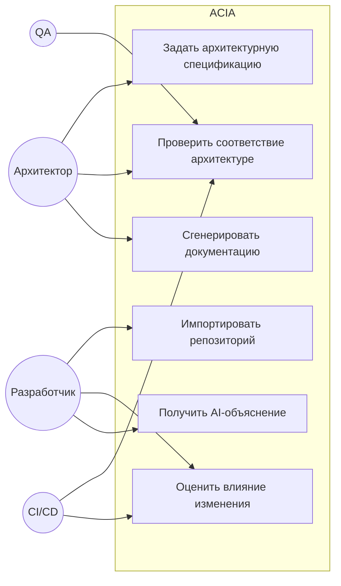
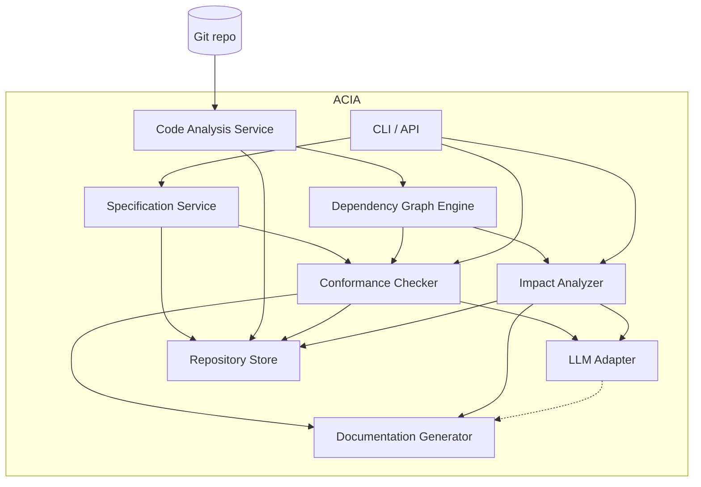
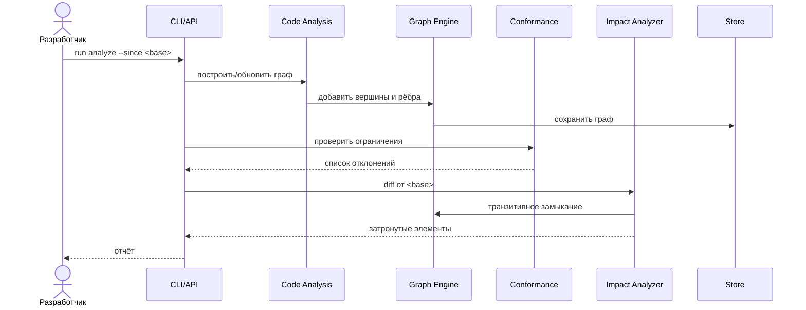
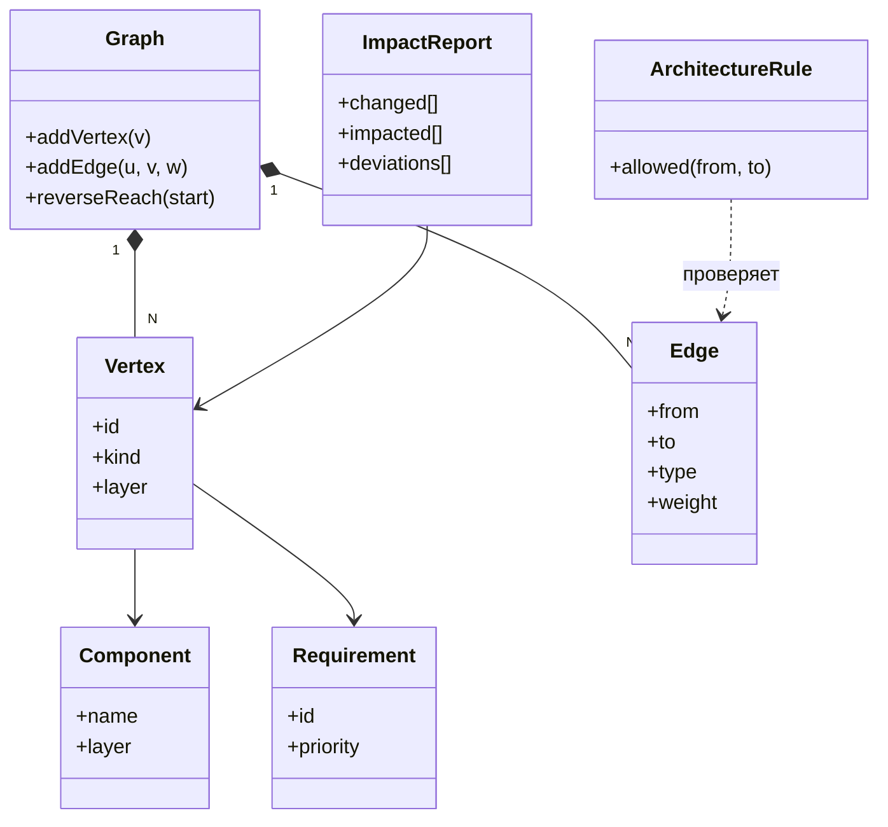

# Проектный отчёт и концепция ВКР

**Рабочее название системы:** Architecture Consistency & Impact Analyzer (ACIA)

**Дисциплина:** Современные проблемы программной инженерии (1 семестр)

**Роль документа:** проектный отчёт, обосновывающий тему выпускной квалификационной работы, и фундамент для последующей разработки.

---

> **Статус документа и соглашения.** Настоящий отчёт описывает *проектируемую* систему. Ни одна из описываемых функций ACIA на момент написания отчёта не реализована. Утверждения о существующих технологиях и инструментах опираются на официальную документацию и общедоступные источники (приведены в тексте); проектные решения ACIA являются авторскими и помечены как «предположение»/«проектное решение». Там, где информации недостаточно для однозначного выбора, перечислены альтернативы и явно указаны допущения.

---

## Содержание

1. [Тема, цель и актуальность разработки](#1-тема-цель-и-актуальность-разработки)
2. [Анализ существующих решений и конкурентов](#2-анализ-существующих-решений-и-конкурентов)
3. [Функциональные и нефункциональные требования](#3-функциональные-и-нефункциональные-требования)
4. [Математическая модель и алгоритмы](#4-математическая-модель-и-алгоритмы)
5. [UML-моделирование](#5-uml-моделирование)
6. [Системный уровень разработки](#6-системный-уровень-разработки)
7. [Архитектура системы](#7-архитектура-системы)
8. [Технологический стек](#8-технологический-стек)
9. [Организация разработки и Git](#9-организация-разработки-и-git)
10. [Использование AI-агента, LLM и SDD](#10-использование-ai-агента-llm-и-sdd)
11. [План разработки MVP](#11-план-разработки-mvp)
12. [Риски и ограничения](#12-риски-и-ограничения)
13. [Заключение](#13-заключение)

---

## 1. Тема, цель и актуальность разработки

### 1.1. Формулировка темы ВКР

**Тема:** «Методы и средства автоматизированного контроля согласованности архитектуры программного обеспечения с исходным кодом и оценки влияния изменений с применением Specification-Driven Development».

### 1.2. Цель разработки

Разработать программную систему ACIA, которая автоматизирует выявление расхождений между архитектурной спецификацией (требованиями, архитектурными ограничениями, описаниями компонентов и решениями ADR) и фактической реализацией (исходным кодом), а также позволяет оценивать влияние изменений кода на компоненты, интерфейсы, требования и тесты.

### 1.3. Объект и предмет исследования

- **Объект исследования** — процесс сопровождения и эволюции программного обеспечения, в котором исходный код, архитектурная документация и требования постепенно расходятся.
- **Предмет исследования** — методы, модели и алгоритмы статического анализа кода, построения ориентированного графа зависимостей, контроля архитектурных ограничений и оценки влияния изменений (Change Impact Analysis).

### 1.4. Актуальность проблемы

В процессе развития ПО накапливается «архитектурный дрейф» (architecture drift): реальная структура кода перестаёт соответствовать документированной архитектуре. Это приводит к росту затрат на сопровождение, увеличению числа дефектов при изменении кода и потере достоверности архитектурной документации. Параллельно растёт объём кода, генерируемого ИИ-ассистентами и агентами, что усиливает риск неконтролируемых изменений архитектуры. Существующие инструменты решают отдельные подзадачи (качество кода, правила слоёв, метрики, технический долг), но не объединяют в едином цикле *спецификацию → код → оценка влияния → актуализация документации* с обязательной проверкой и подтверждением изменений человеком. ACIA закрывает эту нишу, делая спецификацию не статичным документом, а исполняемым артефактом процесса разработки.

### 1.5. Потенциальные пользователи

- **Архитекторы ПО** — контролируют соответствие реализации архитектурным ограничениям, актуализируют документацию.
- **Ведущие разработчики / tech leads** — оценивают масштаб влияния изменений перед ревью.
- **Разработчики** — получают автоматическое объяснение, что именно «сломает» их изменение.
- **QA-инженеры** — определяют, какие тесты и требования затронуты изменением.
- **Руководители проектов** — получают актуальную картину архитектурного здоровья.

### 1.6. Сценарии практического применения

1. CI-проверка: на каждый pull request запускается контроль архитектурных ограничений и оценка влияния изменения; нарушение блокирует слияние.
2. Рефакторинг: перед переносом модуля аналитик видит всех потребителей и транзитивные зависимости.
3. Аудит документации: система находит устаревшие описания и предлагает актуализацию (с подтверждением разработчиком).
4. Контроль AI-кода: код, сгенерированный агентом, проверяется на соответствие спецификации тем же механизмом, что и код человека.

### 1.7. Ожидаемый результат

Действующая система (MVP) на Go, которая:
- строит ориентированный граф зависимостей по Go-репозиторию (AST + git);
- сопоставляет его с архитектурной спецификацией и находит нарушения;
- выполняет Change Impact Analysis по набору изменений (git diff);
- формирует отчёт и «живую» документацию (Mermaid/PlantUML);
- опционально использует LLM для объяснения и рекомендаций, не подменяя детерминированный анализ.

### 1.8. Ограничения и границы проекта

- Первичная поддержка языка Go (расширение на другие языки — за счёт подключаемых адаптеров анализа).
- MVP реализуется одним разработчиком; анализ сосредоточен на статической структуре и зависимостях, без полноценного межпроцедурного dataflow и без динамического анализа.
- LLM не является обязательным компонентом анализа; изменения документации не применяются автоматически без подтверждения человеком.
- Система анализирует «снимок» репозитория (текущее состояние + история git), а не является runtime-монитором.

---

## 2. Анализ существующих решений и конкурентов

### 2.1. Методология сравнения

Сведения о конкурентах взяты из официальных сайтов и документации (на момент исследования):

- SonarQube — https://www.sonarsource.com/products/sonarqube/ и https://docs.sonarsource.com/
- ArchUnit — https://www.archunit.org/
- NDepend — https://www.ndepend.com/
- CodeScene — https://codescene.com/
- Structure101 — https://structure101.com/

Важное фактическое уточнение: Structure101 был приобретён компанией Sonar и **больше не продаётся как самостоятельный продукт** (сведения с structure101.com). Поэтому в таблице ниже он приведён как исторический/интегрируемый инструмент анализа структуры (DSM), а не как конкурирующее активное предложение.

### 2.2. Сводная таблица сравнения

| Критерий | SonarQube | ArchUnit | Structure101 | NDepend | CodeScene |
|---|---|---|---|---|---|
| Назначение | Платформа контроля качества, безопасности и верификации кода | Java-библиотека проверки архитектуры в unit-тестах | Анализ структуры кода, матрица зависимостей (DSM) | Статический анализ и метрики .NET, правила на C# LINQ | Поведенческий анализ кода и техдолга по истории Git |
| Основные возможности | SAST, taint-анализ, секреты, IaC, SCA, quality gates, отчёты | Правила зависимостей между пакетами/классами/слоями, поиск циклов | Dependency Structure Matrix, диаграммы слоёв, циклы | ~100 метрик, граф зависимостей, правила CQLinq, оценка долга | CodeHealth™, hot spots, приоритизация долга, AI-readiness |
| Анализ архитектуры | Да: «living map» из кода + фиксация дрейфа от задуманной структуры | Да, но только как код правил, написанных разработчиком | Да: визуализация структуры и слоёв | Да: граф и матрица зависимостей, правила | Косвенно: через метрики и hot spots, не формальная модель |
| Анализ зависимостей | Да (частично, через анализ структуры) | Да: прямые и циклические зависимости | Да: сильная сторона (DSM) | Да: граф и DSM | Косвенно |
| Оценка влияния изменений | Через quality gate и diff (новые issues), без формального транзитивного impact-модели | Нет | Нет | Есть diff от baseline и «новые issues» | Есть (по истории Git, hot spots), не транзитивный граф |
| Контроль соответствия спецификации | Частично: правила и quality gates, но спецификация не является моделью данных | Частично: правила жёстко закодированы в тестах | Нет | Частично: правила CQLinq | Нет |
| Генерация документации | Отчёты по стандартам (PDF), не «живая» арх. документация | Нет | Диаграммы структуры | Веб-отчёты | Отчёты и метрики |
| Использование AI | Да: AI CodeFix, Remediation/Hunter/Vortex-агенты, MCP | Нет | Нет | Да: NDepend.AI, MCP Server | Да: CodeHealth™ MCP, AI-рефакторинг |
| Ограничения | Архитектурная модель ограничена; не связывает требования-компоненты-тесты в одном графе | Только Java/.NET; правила вручную; нет оценки влияния | Продукт поглощён Sonar, не продаётся | Только .NET; коммерческая лицензия | Фокус на метриках и Git-истории, а не на формальной спецификации |

### 2.3. Ключевые выводы

1. **SonarQube** наиболее близок по направлению (у него уже есть выявление архитектурного дрейфа и AI-агенты), но архитектурная модель остаётся набором правил, а не полноценной машиночитаемой спецификацией, связывающей требования, компоненты, интерфейсы и тесты.
2. **ArchUnit** реализует идею «исполняемой архитектуры», но только для JVM и с правилами в виде кода, который поддерживает сам разработчик; нет графа как сущности и нет impact-анализа.
3. **NDepend** даёт мощный граф зависимостей и diff от baseline для .NET, но не имеет модели спецификации и транзитивной оценки влияния с классификацией затронутых элементов.
4. **CodeScene** уникален поведенческим анализом (история Git), но не является инструментом контроля соответствия спецификации.
5. **Structure101** — исторически сильный инструмент структурного анализа (DSM), но после приобретения Sonar не развивается как самостоятельный продукт.

### 2.4. Отличительные особенности и ниша ACIA

ACIA не претендует на роль «замены» перечисленных инструментов и не утверждает, что аналогов нет. Ниша ACIA — **связывание формальной спецификации с графом зависимостей в едином цикле SDD**:

- Единая модель данных: требования, архитектурные ограничения, компоненты, интерфейсы, тесты и код представлены как вершины и рёбра одного ориентированного графа, что позволяет выполнять транзитивный Change Impact Analysis с классификацией затронутых элементов (не только «новые issues», а именно: какие API/требования/тесты затронуты и почему).
- Спецификация как исполняемый артефакт: контроль соответствия реализован как проверка рёбер графа кода против разрешённых рёбер спецификации (а не как отдельные правила).
- Детерминированный анализ + опциональная AI-интерпретация: LLM не подменяет статический анализ, а лишь объясняет и приоритизирует результаты.
- Обязательное подтверждение человеком любых автоматических изменений документации.

---

## 3. Функциональные и нефункциональные требования

Полный каталог требований с идентификаторами приведён в `specs/product/requirements.md`. Здесь — сводка и приоритизация.

### 3.1. Функциональные требования (сводка)

| ID | Название | Приоритет |
|---|---|---|
| FR-001 | Управление функциональными и нефункциональными требованиями | Высокий |
| FR-002 | Управление архитектурными ограничениями | Высокий |
| FR-003 | Управление описаниями компонентов и интерфейсов | Высокий |
| FR-004 | Управление архитектурными решениями (ADR) | Средний |
| FR-005 | Импорт и анализ структуры Go-проекта (AST) | Высокий |
| FR-006 | Построение ориентированного графа зависимостей | Высокий |
| FR-007 | Сопоставление архитектурной модели с реализацией | Высокий |
| FR-008 | Обнаружение нарушений архитектурных ограничений | Высокий |
| FR-009 | Обнаружение несоответствий «требования ↔ код» | Средний |
| FR-010 | Обнаружение изменений по git diff | Высокий |
| FR-011 | Change Impact Analysis (транзитивное замыкание) | Высокий |
| FR-012 | Классификация затронутых элементов | Средний |
| FR-013 | Формирование отчёта о влиянии изменений | Высокий |
| FR-014 | Генерация архитектурных диаграмм (Mermaid/PlantUML) | Средний |
| FR-015 | Выявление устаревшей документации | Низкий |
| FR-016 | AI-интерпретация отклонений и рекомендаций | Низкий (опционально) |

### 3.2. Нефункциональные требования (сводка)

- **NFR-01 Производительность:** анализ среднего Go-проекта (< 100 тыс. LOC) — не более 60 с на локальной машине; графовые операции выполняются в памяти.
- **NFR-02 Масштабируемость:** модульный монолит с чётко разделёнными модулями; возможность выделения сервисов без изменения модели данных.
- **NFR-03 Безопасность:** ключи доступа к LLM хранятся вне репозитория; анализ репозитория выполняется локально; нет обязательной отправки кода во внешние сервисы.
- **NFR-04 Расширяемость:** адаптеры анализа по языкам подключаются без изменения ядра.
- **NFR-05 Надёжность:** детерминированные результаты анализа воспроизводимы для одного и того же состояния репозитория.
- **NFR-06 Удобство использования:** CLI с человекочитаемым выводом; опционально веб-интерфейс.
- **NFR-07 Сопровождаемость:** модульная гексагональная структура, покрытие тестами ключевых алгоритмов.

### 3.3. Пользовательские сценарии (Use Cases)

Подробно описаны в `specs/product/requirements.md`. Основные:

- UC-01 «Импортировать репозиторий и построить граф».
- UC-02 «Задать/обновить архитектурную спецификацию».
- UC-03 «Проверить соответствие кода архитектуре».
- UC-04 «Оценить влияние изменения (PR)».
- UC-05 «Сгенерировать и актуализировать документацию».
- UC-06 «Получить AI-объяснение отклонения» (опционально).

### 3.4. MVP и перспективные возможности

**MVP:** FR-001, FR-002, FR-003, FR-005, FR-006, FR-007, FR-008, FR-010, FR-011, FR-013.

**Перспективные:** FR-004 (ADR в полном виде), FR-009, FR-012 (полная классификация), FR-014, FR-015, FR-016, веб-интерфейс, поддержка других языков.

---

## 4. Математическая модель и алгоритмы

### 4.1. Модель: ориентированный граф зависимостей

Ядром системы является ориентированный граф

$$G = (V, E),$$

где вершины и рёбра типизированы.

**Типы вершин** (`V = V_{code} \cup V_{req} \cup V_{arch} \cup V_{test} \cup V_{ext}`):

- $V_{code}$ — элементы кода: модуль (пакет), файл, тип/структура, функция/метод;
- $V_{req}$ — требования (функциональные и нефункциональные);
- $V_{arch}$ — архитектурные ограничения и ADR;
- $V_{test}$ — тестовые артефакты;
- $V_{ext}$ — внешние зависимости (модули сторонних библиотек).

**Типы рёбер** (`E = E_{dep} \cup E_{sat} \cup E_{con} \cup E_{test}`):

- $E_{dep}$ — отношения зависимости: `imports`, `calls`, `depends-on`, `implements` (между элементами кода);
- $E_{sat}$ — отношения трассировки: `satisfies`, `traces-to` (связывают код с требованиями);
- $E_{con}$ — отношения ограничения: `constrained-by`, `allowed-to-use` (связывают элементы кода с архитектурными правилами);
- $E_{test}$ — отношения тестирования: `tests`, `covers` (связывают тесты с кодом).

Каждое ребро $e \in E$ несёт вес $w(e) \ge 0$, отражающий «силу» связи (например, прямой импорт весит меньше, чем вызов интерфейса, критичного для публичного API). Веса задаются конфигурацией и являются проектным допущением.

### 4.2. Представление компонентов и архитектурных ограничений

Архитектурная спецификация формализуется как **разрешённое отношение зависимостей** между логическими слоями/компонентами:

$$A \subseteq L \times L,$$

где $L$ — множество логических компонентов (слоёв). Например, для слоёв `domain`, `application`, `infrastructure`, `interfaces` разрешённое отношение может содержать пару `(application, domain)`, но не `(domain, infrastructure)`.

Функция `layer(v)` сопоставляет элемент кода $v \in V_{code}$ логическому компоненту $l \in L$.

**Нарушение архитектурного ограничения** — это ребро $(u, v) \in E_{dep}$ такое, что

$$(layer(u), layer(v)) \notin A.$$

Дополнительно проверяется отсутствие циклов между логическими компонентами (запрет циклических зависимостей на уровне слоёв), если это задано ограничением.

### 4.3. Связь требований, компонентов, кода и тестов

Согласованность моделируется через отношения трассировки $E_{sat}$ и $E_{test}$:

- требование $r$ «покрывается», если существует хотя бы один путь $r \to \dots \to v$ в подграфе трассировки, где $v \in V_{code}$;
- тест $t$ «покрывает» код $v$, если $(t, v) \in E_{test}$.

Это позволяет при изменении элемента кода определить затронутые требования и тесты.

### 4.4. Алгоритм Change Impact Analysis

**Вход:** множество изменённых вершин $\Delta \subseteq V_{code}$ (получается из git diff путём сопоставления изменённых файлов с вершинами графа).

**Шаг 1 — непосредственные зависимости.** Для каждого $v \in \Delta$ находятся прямые потребители: вершины $u$, для которых существует ребро $u \to v \in E_{dep}$ (входящие рёбра в направлении зависимости).

**Шаг 2 — транзитивное замыкание.** Множество затронутых элементов определяется обратной достижимостью в подграфе зависимостей $E_{dep}$:

$$Impact(\Delta) = \{ u \in V \mid \exists\, v \in \Delta : v \leadsto^* u \text{ по обратным рёбрам } E_{dep} \}.$$

Практически это BFS/DFS от $\Delta$ по входящим рёбрам с релаксацией весов (алгоритм Дейкстры/модифицированный BFS), что даёт и множество, и степень влияния.

**Шаг 3 — оценка степени влияния.** Для каждого $u \in Impact(\Delta)$ вычисляется «оценка влияния» $I(u)$ как минимальный по всем путям суммарный вес (или расстояние с учётом весов):

$$I(u) = \min_{v \in \Delta} d(v, u),$$

где $d(v,u)$ — минимальная стоимость пути по обратным рёбрам. Чем меньше $I(u)$, тем сильнее влияние.

**Шаг 4 — классификация.** Элементы $u$ разбиваются на классы:

- **непосредственно затронутые** — $u$ связан с $\Delta$ прямым ребром;
- **косвенно затронутые** — $u$ достижим только через транзитивные пути;
- **затронутые API/требования/тесты** — $u \in V_{req} \cup V_{test}$ либо публичный интерфейс, достижимый из $Impact(\Delta)$.

### 4.5. Алгоритм определения архитектурных отклонений

**Вход:** граф кода $G$, разрешённое отношение $A$, функция `layer`.

**Алгоритм:**
1. Построить $E_{dep}$ по AST и карте пакетов.
2. Для каждого $(u, v) \in E_{dep}$ проверить $(layer(u), layer(v)) \in A$; при невыполнении зафиксировать отклонение.
3. Для проверки циклических зависимостей слоёв — применить поиск циклов (DFS с раскраской или алгоритм Тарьяна для компонент сильной связности) на графе слоёв.
4. Сформировать список отклонений с указанием ребра, слоёв и контекста.

### 4.6. Детерминированное и AI-зависимое

- **Детерминированно:** построение графа, поиск зависимостей, транзитивное замыкание, проверка ограничений, поиск циклов — всё это чисто алгоритмические операции и не требует LLM.
- **AI (опционально):** объяснение причины отклонения, приоритизация отклонений по бизнес-важности, формулировка рекомендаций и черновиков изменений документации. Каждое AI-предложение требует подтверждения разработчиком.

Введённые формулы описывают именно ту часть системы, которая будет реализована детерминированно; математический аппарат вводится только там, где он непосредственно используется (граф зависимостей, транзитивное замыкание, проверка принадлежности разрешённому отношению).

---

## 5. UML-моделирование

Ниже перечислены UML-диаграммы проекта. Исходники в формате PlantUML находятся в `specs/architecture/diagrams/`; здесь для наглядности приведены эквивалентные диаграммы в Mermaid.

Перечень диаграмм:
- `use-case.puml` — Use Case Diagram (акторы и сценарии).
- `component.puml` — Component Diagram (модули ACIA и зависимости).
- `sequence-analysis.puml` — Sequence Diagram (сценарий анализа PR).
- `activity-change-impact.puml` — Activity Diagram (алгоритм Change Impact Analysis).
- `class.puml` — Class Diagram (ключевые доменные сущности).

### 5.1. Use Case Diagram (Mermaid)



### 5.2. Component Diagram (Mermaid)



### 5.3. Sequence Diagram — сценарий анализа PR



### 5.4. Activity Diagram — Change Impact Analysis

```mermaid
flowchart TD
    Start([Начало]) --> Diff[Получить Δ из git diff]
    Diff --> Map[Сопоставить файлы с вершинами графа]
    Map --> BFS[BFS по обратным рёбрам зависимостей]
    BFS --> Score[Вычислить оценку влияния I(u)]
    Score --> Class[Классифицировать элементы]
    Class --> Report[Сформировать отчёт]
    Report --> End([Конец])
```

### 5.5. Class Diagram — доменные сущности (Mermaid)



---

## 6. Системный уровень разработки

ACIA рассматривается как отдельная система («чёрный ящик») в модели Input — Process — Output.

### 6.1. Входная информация и источники

| Вход | Источник | Назначение |
|---|---|---|
| Исходный код (репозиторий) | Git-репозиторий (локальный клон) | Основа для статического анализа и графа |
| История изменений | Git (commits, diff) | Определение $\Delta$ для impact-анализа |
| Архитектурная спецификация | Файлы `specs/` (требования, ограничения, ADR) | Эталон для контроля соответствия |
| Параметры запуска | CLI-аргументы, конфигурация | Управление режимом и порогами |
| Опционально: промпт к LLM | Разработчик/API | Запрос объяснения/рекомендации |

### 6.2. Выходная информация и получатели

| Выход | Получатель | Назначение |
|---|---|---|
| Отчёт об отклонениях | Архитектор, разработчик, CI | Фиксация нарушений ограничений |
| Отчёт о влиянии изменения | Разработчик, tech lead, QA | Масштаб и классификация изменений |
| Архитектурные диаграммы | Архитектор, команда | Актуализированная документация |
| Черновики изменений документации | Архитектор (на подтверждение) | Предложения актуализации |
| Статус проверки (exit code) | CI/CD | Блокировка/пропуск слияния |

### 6.3. Границы ответственности

ACIA **не** изменяет код и **не** модифицирует документацию автоматически; она читает репозиторий, анализирует и формирует результаты. Внешние системы: Git (источник), опционально LLM-провайдер (только для интерпретации), опционально CI/CD (потребитель статуса).

### 6.4. Модель Input — Process — Output

```
Вход                       Процесс                        Выход
─────────────────────────  ─────────────────────────────  ──────────────────────────
Код (git)          ──────►  Статический анализ (AST)   ──►  Граф зависимостей
История (diff)     ──────►  Построение графа           ──►  Отклонения от архитектуры
Спецификация       ──────►  Проверка ограничений       ──►  Отчёт о влиянии изменений
Параметры          ──────►  Change Impact Analysis     ──►  Диаграммы (Mermaid/PlantUML)
Промпт LLM (опц.)  ──────►  AI-интерпретация (опц.)    ──►  Черновики документации
```

---

## 7. Архитектура системы

### 7.1. Выбор укрупнённой архитектуры

- **Клиент-серверная модель** — принята как способ доступа (CLI/API как клиент к ядру), но не как единственный принцип организации кода.
- **Модульный монолит** — **принят** как основной вариант для MVP: один процесс, но жёстко разделённые модули с изолированными границами.
- **Гексагональная архитектура** — **принята** как внутренняя структура ядра (домен + порты + адаптеры), что упрощает тестирование и замену адаптеров (Git, БД, LLM).
- **Микросервисы** — **отклонены** для MVP: для однопользовательского анализа они дают издержки оркестрации и распределённого состояния без реального выигрыша.

**Обоснование:** модульный монолит с гексагональной организацией сочетает простоту развёртывания (один процесс) с возможностью позднее выделить модули в отдельные сервисы без изменения доменной модели (инверсия зависимостей через порты).

### 7.2. Основные модули и их ответственность

| Модуль | Ответственность |
|---|---|
| `interfaces` (CLI/HTTP) | Приём команд, вывод отчётов, exit-коды |
| `spec` (Specification) | Хранение и валидация требований, ограничений, ADR |
| `analysis` (Code Analysis) | AST-анализ Go-кода, извлечение зависимостей |
| `graph` (Graph Engine) | Модель графа, транзитивное замыкание, поиск циклов |
| `conformance` (Conformance) | Сопоставление графа со спецификацией, поиск отклонений |
| `impact` (Impact Analyzer) | Change Impact Analysis и классификация |
| `docgen` (Documentation) | Генерация диаграмм и черновиков документации |
| `llm` (LLM Adapter) | Опциональная интерпретация через DeepSeek 4 Pro |
| `repo` (Repository Store) | Персистентность (PostgreSQL) и/или файловое хранилище |
| `git` (Git Adapter) | Работа с репозиторием, diff, история |

### 7.3. Взаимодействия и потоки данных

1. `interfaces` получает команду и вызывает соответствующий сервис.
2. `analysis` читает код через `git`/файловую систему, строит AST и передаёт вершины/рёбра в `graph`.
3. `conformance` берёт граф и спецификацию из `spec`, вычисляет отклонения.
4. `impact` берёт diff из `git` и граф из `graph`, выполняет замыкание.
5. `docgen` формирует отчёты и диаграммы; `llm` (если включён) дополняет объяснениями.
6. Результаты сохраняются через `repo` и возвращаются в `interfaces`.

### 7.4. Внутренние и внешние интерфейсы

- **Внутренние:** порты (интерфейсы) между доменом и адаптерами (например, `GraphStore`, `SourceReader`, `LLMClient`, `DocumentRenderer`).
- **Внешние:** Git (чтение), PostgreSQL (хранение), LLM-провайдер (HTTP API DeepSeek), файловая система (конфиг и артефакты), CI/CD (exit-коды и машиночитаемый JSON-вывод).

### 7.5. Взаимодействие с LLM и Git

- **LLM:** изолированный адаптер; вызывается только для интерпретации/рекомендаций, результат помечается как «предложение» и не меняет состояние без подтверждения.
- **Git:** только чтение (clone/fetch, log, diff, blame); ACIA не делает push и не создаёт автоматических коммитов.

### 7.6. Хранение данных

Основное хранилище — PostgreSQL (см. Раздел 8). Для офлайн-режима MVP допустимо хранение графа и спецификации в локальном файловом формате (SQLite/файлы), что снижает порог запуска.

### 7.7. Расширяемость

Добавление нового языка анализа сводится к новому адаптеру `SourceReader`, реализующему порт анализа; добавление нового LLM-провайдера — к новому адаптеру `LLMClient`; изменение правил контроля — к изменению данных спецификации, а не кода ядра.

Полное описание архитектуры — в `specs/architecture/overview.md`.

---

## 8. Технологический стек

Полное обоснование — в `docs/technology-stack.md`. Сводка выбора:

| Категория | Выбор | Обоснование |
|---|---|---|
| Язык backend | Go | Статическая типизация, нативная работа с AST (`go/parser`, `go/ast`), богатые библиотеки для графов и Git, низкий порог входа для одного разработчика |
| Frontend | Отложен (CLI на MVP); при необходимости — простая веб-панель | MVP управляется CLI; UI не является блокером ядра |
| СУБД | PostgreSQL (основная); SQLite для офлайн MVP | Надёжность, целостность, соответствие заданию; SQLite для простого старта |
| Работа с Git | `go-git` (чистый Go) или `git` CLI | Чтение истории и diff без внешних зависимостей |
| Статический анализ | стандартные `go/parser`, `go/ast`, `go/types`; опционально `golang.org/x/tools/go/packages` | Встроенные возможности Go, не требуют внешних парсеров |
| Графы | `gonum/graph` или собственная легковесная реализация | Алгоритмы замыкания, поиск циклов, кратчайшие пути |
| Визуализация | Mermaid (основной), PlantUML (опционально) | Текстовая генерация, интеграция в markdown и CI |
| Тестирование | стандартный `testing`, `testify` | Простота, широкое распространение |
| CI/CD | GitHub Actions / GitLab CI | Автоматизация проверок и сборки |
| Контейнеризация | Docker | Воспроизводимое окружение |
| Инструменты разработки | OpenCode + DeepSeek 4 Pro | Соответствует методике SDD (Раздел 10) |

Примечание: выбор конкретных библиотек Go уточняется в ходе реализации; выше указаны предпочтительные варианты с обоснованием. Детальное сравнение альтернатив приведено в `docs/technology-stack.md`.

---

## 9. Организация разработки и Git

### 9.1. Структура репозитория

```
acia/
├── cmd/acia/            # точка входа CLI
├── internal/            # домен и сервисы
│   ├── spec/
│   ├── analysis/
│   ├── graph/
│   ├── conformance/
│   ├── impact/
│   ├── docgen/
│   └── llm/
├── adapters/            # Git, DB, LLM, file adapters
├── specs/               # спецификации (продукт, архитектура, ADR)
├── docs/                # отчёты и документация
├── .github/workflows/   # CI
└── go.mod
```

### 9.2. Стратегия ветвления

- **`main`** — стабильная ветка, защищена; слияние только через PR с прохождением CI.
- **`develop`** — интеграционная ветка (опционально для MVP).
- **`feature/<id>`** — ветки функциональности (по одному требованию/функции).
- **`docs/<topic>`** — ветки изменений документации и спецификаций.

### 9.3. Правила коммитов

Используются Conventional Commits: `feat:`, `fix:`, `docs:`, `refactor:`, `test:`, `chore:` с привязкой к идентификатору требования/ADR (например, `feat(FR-005): import Go AST`).

### 9.4. Порядок code review

1. Любое изменение — через PR.
2. CI выполняет линт, тесты, сборку и (при наличии) проверку согласованности.
3. Изменения архитектуры и требований проходят обязательное ревью архитектора и фиксируются ADR.

### 9.5. Контролируемое изменение спецификаций

Изменение `specs/` (требования, архитектура, ADR) — это отдельный процесс: PR с описанием мотивации, ревью, обновление связанных ADR, проверка согласованности всех зависимых документов. Изменения спецификации не смешиваются с изменениями кода в одном PR без явного обоснования.

---

## 10. Использование AI-агента, LLM и SDD

Это центральный методический раздел. Полное описание процесса — в `docs/sdd-workflow.md`; структура SDD-файлов — в `specs/architecture/decisions/`.

### 10.1. Что такое Specification-Driven Development (SDD)

SDD — методология, при которой **единственным источником истины** является формализованная спецификация, а код, тесты и документация выводятся из неё и проверяются на соответствие ей. В отличие от обычного «AI-assisted coding» (когда LLM свободно генерирует код по текстовому запросу) и «вайб-кодинга» (когда разработчик итеративно «подгоняет» сгенерированный код без формальной спецификации), SDD фиксирует требования и контракты **до** написания кода и делает проверку соответствия автоматической.

Ключевые отличия SDD:

| Критерий | Вайб-кодинг | AI-assisted coding | SDD |
|---|---|---|---|
| Источник истины | Настроение/разговор с LLM | Текстовый запрос | Формальная спецификация |
| Проверяемость | Слабая | Частичная (тесты ad hoc) | Автоматическая (приёмка по спецификации) |
| Управление изменениями | Неявное | Неявное | Явное (спецификация → код → проверка → актуализация) |
| Риск дрейфа архитектуры | Высокий | Средний | Низкий (контроль на каждом шаге) |

### 10.2. Использование OpenCode и DeepSeek 4 Pro

- **OpenCode** — AI-агент-ассистент разработки, которому делегируется реализация по утверждённым спецификациям.
- **DeepSeek 4 Pro** — LLM-модель, используемая как движок агента и как опциональный интерпретатор результатов в самой ACIA.

> Важно: функции, приписываемые OpenCode и DeepSeek, ограничены тем, что подтверждено их документацией. OpenCode рассматривается как агент, принимающий контекст и задачи и возвращающий изменения кода; DeepSeek — как модель для генерации и объяснения. Любые утверждения о внутренних механизмах, выходящие за рамки публичной документации, в отчёте не делаются.

### 10.3. Разделение задач между разработчиком и AI-агентом

**За разработчиком остаются:**
- формирование и утверждение продуктовой спецификации;
- принятие архитектурных решений (ADR);
- приёмка и ревью сгенерированного кода;
- подтверждение любых изменений документации;
- определение критериев приёмки и запуск контрольных проверок.

**Агенту делегируется:**
- декомпозиция спецификации в задачи и черновики спецификаций функций;
- реализация кода по утверждённой спецификации;
- генерация тестов по acceptance criteria;
- формирование черновиков документации и диаграмм.

### 10.4. Как агент получает контекст

Агент получает: (1) продуктовую спецификацию и каталог требований, (2) спецификацию функции, (3) архитектурное описание и ADR, (4) технические контракты/интерфейсы, (5) правила генерации кода (стиль, структура). Контекст передаётся через файлы в репозитории (например, `specs/`, `docs/`, `AGENTS.md`), а не через импровизированные промпты.

### 10.5. Обеспечение следования спецификациям и проверка результата

1. Каждая функция имеет спецификацию с acceptance criteria.
2. Агент генерирует код и тесты строго по контракту.
3. CI запускает тесты, линтер и проверку согласованности.
4. Результат сравнивается со спецификацией; несоответствие возвращается агенту на доработку.

### 10.6. Предотвращение неконтролируемого изменения архитектуры

- Изменение архитектуры возможно только через ADR и ревью архитектора.
- Агент не имеет прав изменять `specs/architecture/` без отдельного разрешения.
- CI содержит проверку согласованности: любое отклонение от разрешённого отношения зависимостей блокирует слияние.
- Агенту явно запрещено менять публичные интерфейсы без обновления контракта и спецификации.

### 10.7. Пример жизненного цикла функции (требование → спецификация → реализация → тест → проверка)

**Функция:** «Импорт Go-пакета и извлечение зависимостей» (FR-005).

1. **Требование:** FR-005 — анализ структуры Go-проекта через AST.
2. **Спецификация функции:** вход — путь к пакету; выход — список элементов и рёбер зависимостей; acceptance criteria — корректная обработка `import`, `func`, `type`, рекурсивный обход вложенных пакетов.
3. **Архитектурное решение:** адаптер `analysis` реализует порт `SourceReader`; зависимости только `graph` → ядро.
4. **Реализация:** агент пишет `internal/analysis/*.go` по спецификации.
5. **Тесты:** unit-тесты на фикстурах пакетов; проверка, что граф содержит ожидаемые рёбра.
6. **Проверка соответствия:** CI запускает тесты + проверку архитектурных ограничений; результат сверяется с acceptance criteria.

### 10.8. Структура SDD-файлов в репозитории

```
specs/
├── product/requirements.md          # каталог требований (FR/NFR + acceptance criteria)
├── product/use-cases.md             # сценарии
├── architecture/overview.md         # архитектурное описание
├── architecture/diagrams/           # UML-диаграммы
├── architecture/decisions/          # ADR
└── functions/<function-id>.md       # спецификация отдельной функции (контракт + acceptance criteria)
```

---

## 11. План разработки MVP

### 11.1. Этапы

| Этап | Цель | Задачи | Артефакты | Критерии завершения |
|---|---|---|---|---|
| 1. Каркас и домен | Запустить скелет приложения | Модульная структура, модель графа, конфиг, CLI | `cmd/`, `internal/graph`, `go.mod` | `go build` и `go test` проходят; CLI отвечает на `--help` |
| 2. Спецификации | Формализовать требования и архитектуру | Каталог FR/NFR, обзор архитектуры, ADR | `specs/` | Согласованность документов, уникальные ID |
| 3. AST-анализ | Извлекать зависимости из Go-кода | Адаптер `analysis`, обход AST | `internal/analysis` | Для фикстур строится корректный граф импортов/вызовов |
| 4. Граф | Построить и сохранять граф | Вершины/рёбра, замыкание, поиск циклов | `internal/graph` | Юнит-тесты замыкания и циклов |
| 5. Соответствие | Находить отклонения | Проверка разрешённого отношения, отчёт | `internal/conformance` | Нарушение обнаруживается на контрольном примере |
| 6. Impact-анализ | Оценивать влияние изменений | git diff → Δ, замыкание, классификация | `internal/impact` | Отчёт содержит затронутые элементы |
| 7. Отчёт и документация | Формировать отчёты и диаграммы | Рендер markdown + Mermaid | `internal/docgen` | Генерируются читаемые отчёты |
| 8. CI и упаковка | Автоматизировать проверки | GitHub Actions, Docker | `.github/workflows`, `Dockerfile` | CI зелёный, образ собирается |
| 9. LLM (опц.) | Добавить AI-интерпретацию | Адаптер `llm`, подтверждение человеком | `internal/llm` | Объяснения помечаются как предложения |

### 11.2. Принципы планирования

MVP сознательно ограничен: один язык (Go), CLI-интерфейс, офлайн-хранилище (файлы/SQLite) с опцией перехода на PostgreSQL. Все функции, не попавшие в MVP, отнесены к перспективным.

---

## 12. Риски и ограничения

| Риск/ограничение | Описание | Меры минимизации |
|---|---|---|
| Технический: сложность парсинга | Восстановление точной структуры по AST/коду | Использовать встроенные `go/parser`, `go/types`; ограничить MVP Go |
| Технический: масштаб графа | Большое число вершин/рёбер | Инкрементальный анализ, ограничение глубины, бенчмарки |
| Ложноположительные отклонения | Статический анализ может помечать допустимые связи как нарушения | Настраиваемое разрешённое отношение, база исключений, подтверждение человеком |
| Ограничение статического анализа | Динамические зависимости (DI, reflection) не видны | Явно документировать границы; комбинировать с go/types |
| Сложность восстановления архитектуры | Автоматическое извлечение слоёв ненадёжно | Архитектор задаёт соответствие «пакет → слой» в спецификации |
| Оценка влияния | Неточность весов, транзитивное замыкание переоценивает влияние | Веса по типам рёбер, пороги, классификация |
| LLM-галлюцинации | Неверные объяснения/рекомендации | LLM только интерпретация; детерминированный анализ — основа; подтверждение человеком |
| Некорректная актуализация документации | Автоматическая генерация может исказить смысл | Любое изменение документации — через PR и ревью |
| Зависимость от внешнего LLM-API | Доступность, стоимость, приватность кода | LLM опциональна; локальный запуск анализа без неё |

---

## 13. Заключение

В отчёте сформулирована тема ВКР, обоснована актуальность автоматизированного контроля согласованности архитектуры и кода, проведён анализ конкурентов (SonarQube, ArchUnit, Structure101, NDepend, CodeScene) по официальным источникам, определены функциональные и нефункциональные требования, предложена формальная модель на основе ориентированного графа зависимостей с алгоритмами Change Impact Analysis и обнаружения архитектурных отклонений, описана UML-модель, системный и архитектурный уровни, обоснован технологический стек (Go, модульный монолит + гексагональная архитектура, PostgreSQL), определена организация Git-разработки и методика Specification-Driven Development с участием AI-агента OpenCode и модели DeepSeek 4 Pro, сформирован реалистичный план MVP и проанализированы риски.

Практическая ценность работы — создание инструмента, который превращает архитектурную спецификацию в исполняемый артефакт процесса разработки и снижает риск архитектурного дрейфа, в том числе при использовании AI-генерации кода.

---

## Источники

1. SonarQube — официальный сайт. URL: https://www.sonarsource.com/products/sonarqube/
2. ArchUnit — официальный сайт. URL: https://www.archunit.org/
3. NDepend — официальный сайт. URL: https://www.ndepend.com/
4. CodeScene — официальный сайт. URL: https://codescene.com/
5. Structure101 — официальный сайт. URL: https://structure101.com/
6. Go — пакеты `go/parser`, `go/ast`, `go/types`. URL: https://pkg.go.dev/go/ast
7. Go Git — go-git. URL: https://github.com/go-git/go-git
8. gonum/graph. URL: https://pkg.go.dev/gonum.org/v1/gonum/graph
9. Mermaid. URL: https://mermaid.js.org/
10. PlantUML. URL: https://plantuml.com/

> Замечание: список источников будет дополняться в ходе реализации по мере подтверждения конкретных библиотек и версий.
